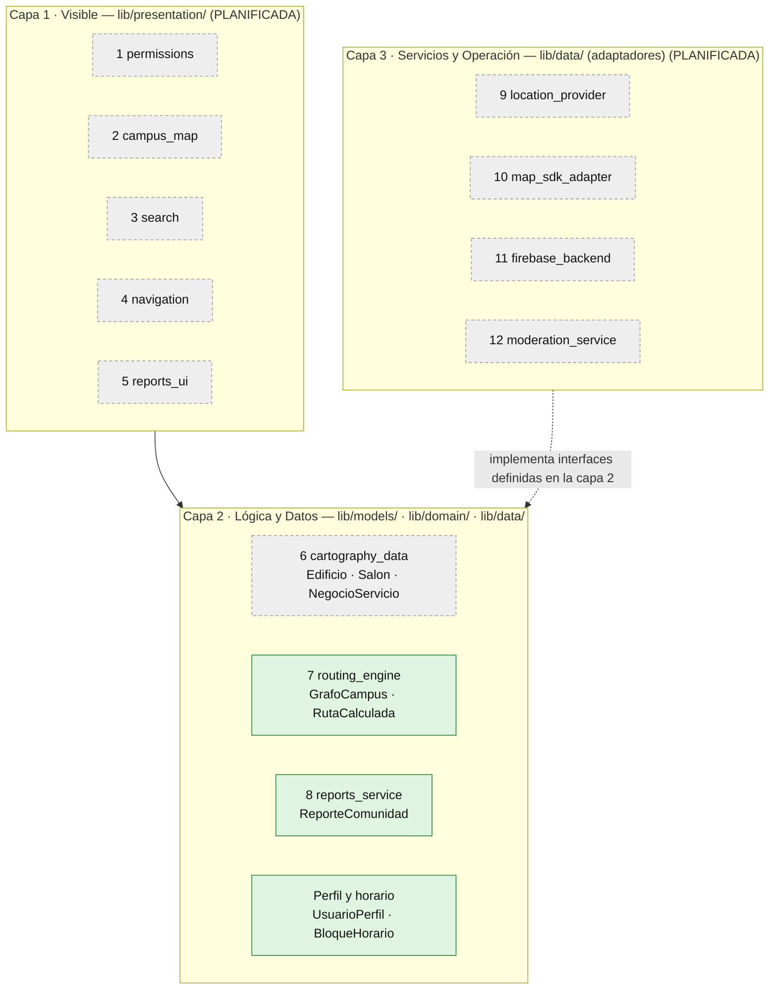
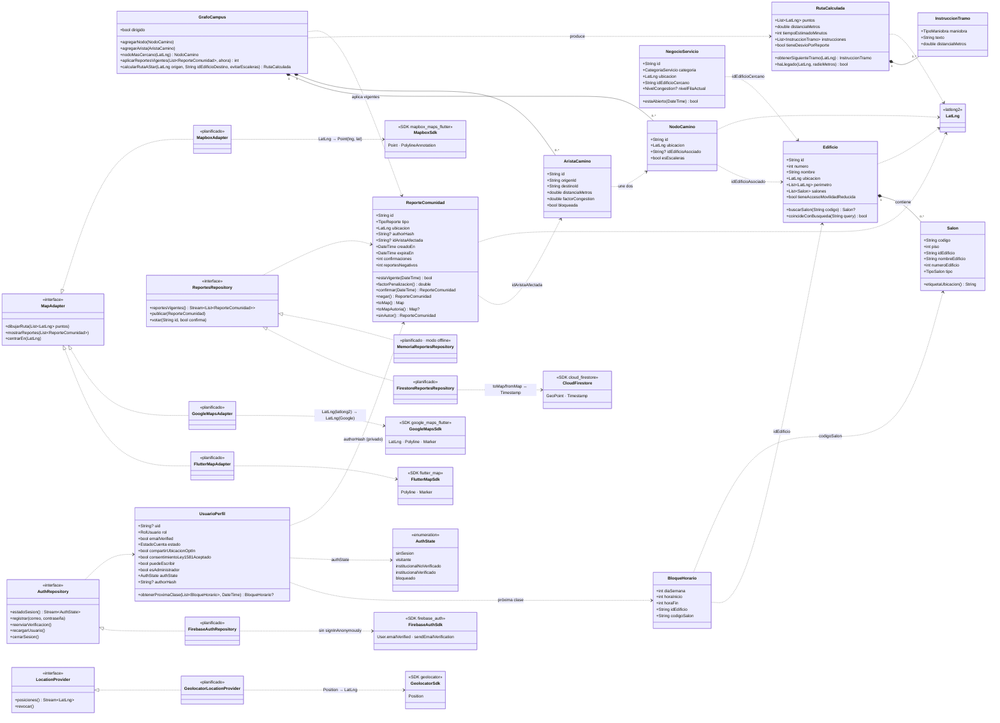
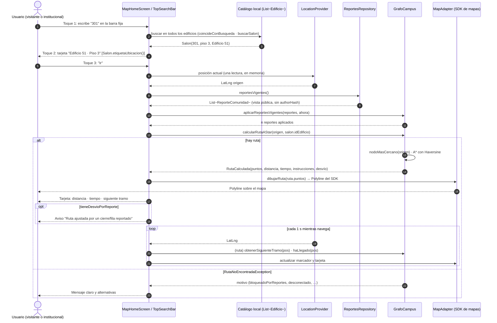
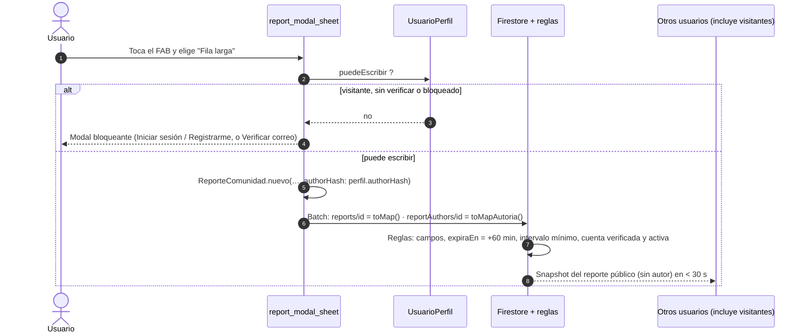

# PontiMaps — Arquitectura de Software y Contratos del Dominio (`ARCHITECTURE.md`)

> **Base:** `REQUIREMENTS.md`. **Alcance de este documento:** arquitectura de 3 capas / 12 módulos aplicada a Flutter, especificación formal de los 7 TADs del dominio, diagramas, y el estado real de la implementación (`lib/models/`, `lib/domain/routing/`).
> **Estado:** dominio puro implementado y probado (`flutter analyze`: 0 problemas; `flutter test`: 118 pruebas pasan). Fases 0 y 1 hechas: tema, métricas, configuración, pantalla inicial y catálogo cartográfico real de OpenStreetMap (`data/campus_cartography.dart`). La capa visible, los repositorios y los adaptadores de mapa **aún no existen**; aparecen en los diagramas marcados como *planificados*. Sincronizado con `USER_PATHS.md` y `REQUIREMENTS.md`: backend en **plan Spark** (Firebase Auth + Firestore con reglas, **sin Cloud Functions**).

---

## 1. Decisiones de diseño y desviaciones respecto a los documentos previos

| # | Decisión | Motivo |
| :--- | :--- | :--- |
| 1 | Los modelos viven en `lib/models/` (no en `lib/domain/models/` como decía la guía). | Pedido explícito del equipo. El motor de rutas sí está en `lib/domain/routing/`. Si se prefiere la guía, es un movimiento de carpeta sin cambios de código. |
| 2 | Nombres del dominio en español (`Edificio`, `Salon`, `ReporteComunidad`…). | Pedido explícito; coincide con el lenguaje del equipo y de la Universidad. |
| 3 | `LatLng` es el de **`latlong2`** (dependencia ya declarada y pura Dart). No se define un `LatLng` propio. | Evita duplicar el SDK y funciona sin emulador. Los adaptadores convierten a `google_maps_flutter.LatLng` / Mapbox `Point` (§4). |
| 4 | Se añaden cuatro utilidades puras en `lib/core/utils/`: `geo_utils.dart` (Haversine, rumbo, distancia punto-segmento), `text_normalizer.dart`, `colecciones.dart` y `author_hash.dart` (SHA-256 con `package:crypto`). | Compartidas por varios TADs. Sin dependencias de Flutter ni de Firebase. |
| 5 | **`GrafoCampus` es mutable** (agrega nodos/aristas y recibe la capa de reportes); los otros 6 TADs son inmutables. | Es un agregado que se construye una vez y se actualiza con cada ciclo de reportes. Las aristas y nodos individuales sí son inmutables, y los reportes se aplican como **capa superpuesta** que reemplaza a la anterior (las aristas base nunca se alteran). |
| 6 | `NegocioServicio.nivelFilaActual` es **`NivelCongestion?`** (anulable). | `null` = "sin datos recientes", que no es lo mismo que fila baja (REQUIREMENTS RF-DIR-04). |
| 7 | `BloqueHorario.horaInicio/horaFin` son **minutos desde la medianoche** (`int`). | Evita `TimeOfDay`, que obliga a importar Flutter. |
| 8 | Los constructores con colecciones o validaciones no son `const`; `Salon`, `BloqueHorario`, `NodoCamino`, `AristaCamino` e `InstruccionTramo` sí. | `List.unmodifiable` y `RegExp` no son constantes. La inmutabilidad se garantiza con listas no modificables. |
| 9 | Los invariantes se declaran con `assert` **y**, donde los datos vienen de fuera (red, login), también con excepciones reales (`ReporteComunidad.fromMap` → `FormatException`; `UsuarioPerfil.institucional` → `ArgumentError`). | Los `assert` no existen en builds *release*. |
| 10 | Los parámetros de vigencia (60/30/180 min, umbral 3 votos, velocidad 1,25 m/s) son constantes estáticas. | Pasarán a `config/appConfig` cuando exista la capa de datos (REQUIREMENTS §4). |
| 11 | **Sin Cloud Functions** (plan Spark): el backend es Firebase Auth + Firestore con reglas. | Decisión cerrada. La verificación de correo usa el enlace nativo de Firebase y toda escritura del cliente la valida una regla. La expiración la decide el cliente con `expiraEn`. Plan B (REQUIREMENTS D-19): plan Blaze + funciones. |
| 12 | `ReporteComunidad.authorHash` es **seudónimo privado**: se excluye de `toMap()` y de `toString()` y viaja por `toMapAutoria()` a un documento aparte (solo administrador y autor). | Los documentos de Firestore se leen completos; un campo en el documento público lo expondría a todos y permitiría enlazar los reportes de una misma persona. |
| 13 | `UsuarioPerfil.uid` es anulable y existen `emailVerified`, `estado` y `RolUsuario.admin`. El visitante no tiene `uid`. `AuthState` y `puedeEscribir` viven en el dominio. | El visitante no tiene sesión en la nube. El Auth Guard queda comprobable sin Firebase. `admin` solo lo asigna la consola: `UsuarioPerfil.registro` lo rechaza. |
| 14 | Un reporte con **≥ 3 votos negativos** se oculta aunque tenga confirmaciones (antes: votos netos). | Decisión cerrada del equipo. |

---

## 2. Arquitectura de 3 capas y 12 módulos en Flutter

### 2.1 Regla de dependencias

Las flechas solo apuntan **hacia adentro**: la UI conoce el dominio; el dominio no conoce a nadie.

Verde = modelos/lógica ya implementados. Gris = por construir. Los *modelos* de los módulos 6 (`Edificio`, `Salon`, `NegocioServicio`) y 8 (`ReporteComunidad`) ya existen; lo que falta de esos módulos es el catálogo semilla y los repositorios.

**Inversión de dependencias:** la capa 2 define interfaces (`ReportesRepository`, `LocationProvider`, `MapAdapter`, `CatalogoRepository`) y la capa 3 las implementa. Así el dominio se prueba sin Firebase ni mapas, y el modo offline (`USE_OFFLINE_FALLBACK`) solo cambia qué implementación se inyecta con Riverpod.

### 2.2 Módulos, carpetas y estado

| # | Módulo | Capa | Carpeta / archivos | Estado |
| :--- | :--- | :--- | :--- | :--- |
| 1 | `permissions` | 1 · Visible | `presentation/screens/permission_screen.dart` | Planificado |
| 2 | `campus_map` | 1 · Visible | `presentation/screens/map_home_screen.dart`, `widgets/` | Planificado |
| 3 | `search` | 1 · Visible | `presentation/widgets/top_search_bar.dart` | Planificado (la lógica `Edificio.coincideConBusqueda` / `buscarSalon` ya existe) |
| 4 | `navigation` | 1 · Visible | `presentation/screens/route_active_screen.dart`, `route_summary_card.dart` | Planificado (la lógica `RutaCalculada` ya existe) |
| 5 | `reports_ui` | 1 · Visible | `presentation/widgets/report_modal_sheet.dart` | Planificado |
| 6 | `cartography_data` | 2 · Lógica y Datos | **`models/edificio.dart`, `models/salon.dart`, `models/negocio_servicio.dart`** · `data/campus_cartography.dart` | Modelos **hechos**; catálogo semilla pendiente |
| 7 | `routing_engine` | 2 · Lógica y Datos | **`domain/routing/grafo_campus.dart`, `cola_prioridad.dart`**, **`models/ruta_calculada.dart`** | **Hecho y probado** |
| 8 | `reports_service` | 2 · Lógica y Datos | **`models/reporte_comunidad.dart`** · `data/reports_repository.dart` | Modelo **hecho**; repositorio pendiente |
| 9 | `location_provider` | 3 · Servicios | `data/location_service.dart` (interfaz `LocationProvider` + GPS + stub BLE) | Planificado |
| 10 | `map_sdk_adapter` | 3 · Servicios | `data/map_sdk_adapter.dart` (+ implementaciones por SDK) | Planificado |
| 11 | `firebase_backend` | 3 · Servicios | `data/auth_repository.dart`, `data/reports_repository.dart` + `firebase/` (reglas de Firestore y emulador; **sin Cloud Functions**) | Planificado |
| 12 | `moderation_service` | 3 · Servicios | `domain/services/moderation_service.dart` y acciones del administrador | Planificado (las reglas de voto y el ocultamiento con ≥ 3 negativos ya viven en `ReporteComunidad.confirmar/negar/estaVigente`) |
| + | Perfil, estado de sesión y horario | 2 · Lógica y Datos | **`models/horario_usuario.dart`** (`BloqueHorario`, `UsuarioPerfil`, `AuthState`, `EstadoCuenta`, `RolUsuario`) | **Hecho y probado** |
| + | Utilidades | transversal | **`core/utils/geo_utils.dart`, `text_normalizer.dart`, `colecciones.dart`, `author_hash.dart`** | **Hecho** |

### 2.3 Qué puede importar cada carpeta

| Carpeta | Puede importar | Prohibido |
| :--- | :--- | :--- |
| `core/utils/`, `models/`, `domain/` | `dart:*`, `package:latlong2`, `package:crypto` y entre sí | `package:flutter/*`, `material_ui`, `cloud_firestore`, `firebase_*`, `google_maps_flutter`, `mapbox_maps_flutter`, `geolocator` |
| `data/` | todo lo anterior + SDKs (Firebase, geolocator, mapas) | widgets |
| `presentation/` | `models/`, `domain/`, interfaces de `data/` | acceso directo a Firestore o GPS |

Hoy se cumple: una búsqueda en `lib/models`, `lib/domain` y `lib/core` no encuentra ninguna importación de Flutter, Firebase ni SDKs de mapas.

---

## 3. Especificación formal de los 7 TADs

Convenciones: *n* = nodos, *m* = aristas, *s* = salones, *p* = puntos de la ruta, *t* = palabras de la consulta, *R* = reportes, *h* = bloques de horario. Todas las clases son inmutables y tienen `copyWith`, `==`, `hashCode` y `toString`, salvo `GrafoCampus` (decisión 5). Ningún TAD guarda coordenadas GPS del usuario.

### 3.1 `Edificio` — `lib/models/edificio.dart`

| Atributo | Tipo | |
| :--- | :--- | :--- |
| `id` | `String` | no vacío |
| `numero` | `int?` | `null` si el edificio no tiene número oficial (Biblioteca, Hospital…); si no, `> 0` |
| `niveles` | `int?` | pisos sobre el suelo (`building:levels` de OpenStreetMap); `null` si se desconoce; ningún salón queda por encima |
| `sotanos` | `int` | niveles subterráneos (`building:levels:underground` / `docs/edificios_ascensores.json`, numerados `-1 … -sotanos`); `>= 0` (por defecto `0`); ningún salón queda en `piso == 0` ni por debajo de `-sotanos` |
| `nombre` | `String` | no vacío |
| `ubicacion` | `LatLng` | |
| `perimetro` | `List<LatLng>` | vacío o ≥ 3 vértices; no modificable |
| `salones` | `List<Salon>` | no modificable |
| `tieneAccesoMovilidadReducida` | `bool` | la entrada es accesible sin escalones (a nivel o con rampa) |
| `tieneAscensor` | `bool` | hay al menos un ascensor público operativo para subir a los pisos altos (`docs/edificios_ascensores.json`) |
| `tieneMultiplesAscensores` | `bool` | hay más de un ascensor (batería); implica `tieneAscensor` |
| `accesibilidadConfirmada` | `bool` | `true` si los tres indicadores fueron levantados; `false` = **no se sabe** (los tres quedan en `false` y la interfaz dice "sin confirmar", nunca "sin ascensor") |

**Invariantes:** varios ascensores implican ascensor; un edificio de un solo nivel no tiene ascensor; sin `accesibilidadConfirmada` los indicadores son `false`; todo salón cumple `idEdificio == id` y `numeroEdificio == numero`; los códigos de salón son únicos (comparados sin espacios ni mayúsculas, el duplicado lanza `ArgumentError`).

| Operación | Firma | Complejidad | Contrato |
| :--- | :--- | :--- | :--- |
| `buscarSalon` | `Salon? buscarSalon(String codigo)` | O(1) (índice interno) | Ignora mayúsculas y espacios. `null` si no existe. |
| `puedeLlegarEnAscensor` | `bool puedeLlegarEnAscensor(int piso)` | O(1) | `true` si se llega al piso **sin escaleras**: `piso == 1` → la entrada es a nivel o con rampa; `piso > 1` o `piso < 0` (sótano) → hay ascensor. `false` si la accesibilidad no está confirmada o el piso/sótano no existe (`piso == 0`, `piso > niveles` o `-piso > sotanos`). |
| `etiquetaAccesibilidadVertical` | `String etiquetaAccesibilidadVertical(int piso)` | O(1) | "Acceso por ascensor disponible (múltiples ascensores)" / "Acceso por ascensor disponible" / "Sin ascensor (solo escaleras internas para piso N)" / "…sin confirmar" / "Acceso a nivel o por rampa". |
| `accesoVertical` | `AccesoVertical accesoVertical(int piso, {bool evitarEscaleras})` | O(1) | Empaqueta lo anterior; con `evitarEscaleras` añade una `advertencia` si el piso solo se alcanza por escaleras. **Es información, no enrutamiento interior** (REQUIREMENTS §1.4): la ruta termina en la entrada. |
| `coincideConBusqueda` | `bool coincideConBusqueda(String query)` | O(t·\|nombre\|) | Sin tildes ni mayúsculas. Ignora "ed", "edificio", "no". Cada palabra debe ser exactamente el número o estar contenida en el nombre. Consulta vacía → `false`. |

### 3.2 `Salon` — `lib/models/salon.dart`

| Atributo | Tipo | |
| :--- | :--- | :--- |
| `codigo` | `String` | no vacío |
| `piso` | `int` | puede ser negativo (sótanos) |
| `idEdificio` | `String` | no vacío |
| `nombreEdificio` | `String` | no vacío |
| `numeroEdificio` | `int?` | `null` si el edificio no tiene número (la etiqueta usa entonces su nombre: `"Biblioteca … · Piso 2"`); si no, `> 0` |
| `tipo` | `TipoSalon` | `aula` (por defecto), `laboratorio`, `auditorio`, `oficina` |

| Operación | Firma | Complejidad | Contrato |
| :--- | :--- | :--- | :--- |
| `etiquetaUbicacion` | `String etiquetaUbicacion()` | O(1) | Siempre `"Edificio X · Piso Y"`. Garantiza la regla "nunca mostrar un salón sin Edificio + Piso". |
| `normalizarCodigo` *(estática)* | `String normalizarCodigo(String)` | O(\|c\|) | Mayúsculas y sin espacios. |

### 3.3 `GrafoCampus`, `NodoCamino`, `AristaCamino` — `lib/domain/routing/grafo_campus.dart`

**`NodoCamino`** (inmutable, `const`): `id` (no vacío), `ubicacion` (`LatLng`), `idEdificioAsociado` (`String?`; un nodo con edificio asociado es una **entrada** y una meta válida), `esEscaleras` (`bool`).

**`AristaCamino`** (inmutable, `const`): `id`, `origenId`, `destinoId`, `distanciaMetros` (`> 0`), `factorCongestion` (`>= 1.0`, base `1.0`), `bloqueada`.
**Invariantes:** `origenId != destinoId`; `factorCongestion >= 1.0` (nunca abarata un tramo, lo que mantiene admisible la heurística). Costo = `distanciaMetros × factorCongestion`.

**`GrafoCampus({bool dirigido = false})`** — grafo ponderado. Cada arista se guarda una sola vez; si `dirigido == false` se recorre en ambos sentidos.

**Invariantes:** ids de nodo y de arista únicos; toda arista referencia nodos existentes; las aristas base nunca cambian después de agregadas.

| Operación | Firma | Complejidad | Contrato |
| :--- | :--- | :--- | :--- |
| `agregarNodo` | `void agregarNodo(NodoCamino)` | O(1) | `ArgumentError` si el id existe. |
| `agregarArista` | `void agregarArista(AristaCamino)` | O(1) | `ArgumentError` si el id existe o un extremo no existe. Actualiza la escala de la heurística. |
| `conectar` *(atajo)* | `void conectar(String id, String origenId, String destinoId, {double? distanciaMetros, …})` | O(1) | Si no se da distancia usa Haversine entre los nodos. |
| `nodoMasCercano` | `NodoCamino nodoMasCercano(LatLng posicion)` | O(n) | `StateError` si el grafo está vacío. |
| `aristaMasCercana` | `AristaCamino? aristaMasCercana(LatLng, {double maxMetros = 30})` | O(m) | `null` si ninguna está dentro del radio. |
| `aplicarReportesVigentes` | `int aplicarReportesVigentes(List<ReporteComunidad>, {DateTime? ahora})` | O(R·m) peor caso | **Reemplaza** la capa de reportes. Ignora los no vigentes en `ahora`. Cada reporte afecta a `idAristaAfectada` o, si falta o no existe, a la arista más cercana (≤ 30 m); si no hay, se ignora. `cierre` → bloquea; `fila`/`altaAfluencia` → sube el factor (se toma el mayor). Devuelve cuántos se aplicaron. |
| `limpiarReportes` | `void limpiarReportes()` | O(1) | Quita toda la capa. |
| `calcularRutaAStar` | `RutaCalculada calcularRutaAStar(LatLng origen, String idEdificioDestino, {bool evitarEscaleras = false, double velocidadMetrosPorSegundo = 1.25})` | O((n+m) log n) peor caso | Ver abajo. |

**Algoritmo `calcularRutaAStar`**

1. El origen se ajusta al nodo más cercano; las metas son todos los nodos con `idEdificioAsociado == idEdificioDestino` (A\* con múltiples metas: llega a la entrada más barata).
2. Costo `g` = Σ `distancia × factor`; las aristas bloqueadas no se recorren; con `evitarEscaleras` se excluyen los nodos `esEscaleras` que no sean meta.
3. Heurística `h(v) = min_meta Haversine(v, meta) × escala`, con `escala = min(1, min_aristas distancia/Haversine)`. Esa escala la hace **admisible y consistente aunque los datos tengan aristas más cortas que la línea recta**, así que el resultado es óptimo y basta una lista de cerrados.
4. Cola de prioridad propia (`ColaPrioridad`, montículo binario, O(log n)) porque Dart no incluye una.
5. `tieneDesvioPorReporte`: si hay capa de reportes se repite la búsqueda ignorándola y se comparan las secuencias de nodos.
6. Tiempo = `costo ponderado / velocidad / 60`, redondeado, mínimo 1 min si hay distancia.

**Errores:** `RutaNoEncontradaException(motivo, mensaje)` con `MotivoSinRuta`: `grafoVacio`, `edificioSinEntradas`, `desconectado`, `bloqueadoPorReportes` (hay camino sin reportes pero los cierres vigentes lo cortan; la UI puede decir *por qué*), `soloPorEscaleras` (con `evitarEscaleras` no hay camino, pero sí usando escalones: en el mapa real de OpenStreetMap varios lugares quedan así).

**Escaleras:** `AristaCamino.esEscaleras` marca un tramo de escalones (`highway=steps`); con `evitarEscaleras` el A\* no lo recorre. `NodoCamino.esEscaleras` sigue existiendo para escaleras puntuales. Las instrucciones emiten la maniobra `escaleras` al entrar a un tramo de escalones, incluso si es el primero de la ruta.

**Rendimiento:** la prueba automatizada exige < 2 s sobre una malla de 14 400 nodos y ≈ 28 000 aristas y pasa en la máquina de desarrollo. **Falta medirlo en un dispositivo de gama media** (RNF-REN-01); el catálogo real del campus tendrá del orden de cientos de nodos, así que hay amplio margen.

### 3.4 `RutaCalculada` e `InstruccionTramo` — `lib/models/ruta_calculada.dart`

| Atributo | Tipo | |
| :--- | :--- | :--- |
| `puntos` | `List<LatLng>` | ≥ 1, no modificable (los usa la Polyline) |
| `distanciaMetros` | `double` | `>= 0`, suma de aristas |
| `tiempoEstimadoMinutos` | `int` | `>= 0`, incluye congestión |
| `instrucciones` | `List<InstruccionTramo>` | ≥ 1, la última es `llegada` |
| `tieneDesvioPorReporte` | `bool` | |
| `accesoVertical` | `AccesoVertical?` | cómo se llega al piso pedido en el edificio destino (ascensor o escaleras internas, y si hay varios ascensores); `null` si la consulta no pidió un piso |

`InstruccionTramo`: `maniobra` (`inicio`, `recto`, `izquierda`, `derecha`, `escaleras`, `llegada`), `texto`, `distanciaMetros`, `indicePuntoInicio`, `indicePuntoFin`. La llegada es un tramo de longitud 0.

| Operación | Firma | Complejidad | Contrato |
| :--- | :--- | :--- | :--- |
| `obtenerSiguienteTramo` | `InstruccionTramo obtenerSiguienteTramo(LatLng posicionActual)` | O(p) | Devuelve la instrucción del tramo que se está recorriendo (segmento más cercano a la posición). Si ya llegó, devuelve `llegada`. **No guarda la posición recibida.** |
| `haLlegado` | `bool haLlegado(LatLng posicionActual, {double radioMetros = 15})` | O(1) | Haversine al último punto ≤ radio. |

Los giros se emiten cuando el rumbo cambia ≥ 30°; las escaleras siempre abren un tramo nuevo.

### 3.5 `ReporteComunidad` — `lib/models/reporte_comunidad.dart`

| Atributo | Tipo | |
| :--- | :--- | :--- |
| `id` | `String` | no vacío |
| `tipo` | `TipoReporte` | `cierre`, `fila`, `altaAfluencia` |
| `ubicacion` | `LatLng` | ubicación del **incidente**, no del usuario |
| `authorHash` | `String?` | SHA-256 (hex, 64 caracteres) del `uid`; `null` en la vista pública. **Nunca se muestra** |
| `idAristaAfectada` | `String?` | |
| `idLugar` | `String?` | negocio al que se ancla una `fila` (RF-DIR-04); `null` si solo pertenece a un tramo |
| `descripcionCorta` | `String` | ≤ 140 caracteres; el MVP no la captura en la interfaz |
| `creadoEn`, `expiraEn` | `DateTime` | |
| `confirmaciones`, `reportesNegativos` | `int` | `>= 0` |

**Invariantes de vigencia:** `creadoEn + 60 min ≤ expiraEn ≤ creadoEn + 180 min`; **sin confirmaciones, `expiraEn == creadoEn + 60 min` exactamente.** No existe ningún campo de nombre, correo ni `uid`.

**Anonimato y moderación (`authorHash`):** el reporte público es visualmente anónimo. El `authorHash` existe únicamente para que un administrador pueda bloquear a quien publica reportes falsos, y por eso:
- `toMap()` (la representación **pública**) **no lo incluye**; viaja aparte en `toMapAutoria()` (`{idReporte, authorHash}`), destinado a un documento que solo leen el administrador y el autor.
- `toString()` tampoco lo imprime.
- `sinAutor()` devuelve la copia sin hash que se entrega a la UI.
- Es **seudonimización, no anonimización** (ver `calcularAuthorHash`): quien conozca los `uid` puede recalcularlo. Se trata como dato personal y no se asocia a coordenadas ni recorridos.

| Operación | Firma | Complejidad | Contrato |
| :--- | :--- | :--- | :--- |
| `ReporteComunidad.nuevo` | `factory …nuevo({id, tipo, ubicacion, ahora, required authorHash, …})` | O(1) | Nace con `expiraEn = ahora + 60 min`. Exige un `authorHash` válido: un visitante no puede publicar. |
| `estaVigente` | `bool estaVigente(DateTime ahora)` | O(1) | `ahora < expiraEn` **estricto** (a los 59:59 sí, a los 60:00 no) **y** `reportesNegativos < 3`. Con **3 o más votos negativos ("Falso / Ya no está") se oculta**, aunque tenga confirmaciones. |
| `factorPenalizacion` | `double factorPenalizacion()` | O(1) | `cierre` → `∞`; `fila` → 1,5; `altaAfluencia` → 1,3; 1,0 si los negativos superan a las confirmaciones. |
| `confirmar` | `ReporteComunidad confirmar(DateTime ahora)` | O(1) | `expiraEn' = min(creadoEn + 180 min, expiraEn + 30 min)`; `confirmaciones + 1`. Un reporte vencido u oculto no se revive (devuelve `this`). |
| `negar` | `ReporteComunidad negar()` | O(1) | `reportesNegativos + 1`; no altera `expiraEn`. |
| `toMap` / `toMapAutoria` | `Map<String, Object?> toMap()` · `Map<String, Object?>? toMapAutoria()` | O(1) | Fechas en milisegundos UTC; la capa de datos las convierte a `Timestamp`. `toMapAutoria()` es `null` si no se conoce el autor. |
| `fromMap` | `factory ReporteComunidad.fromMap(Map<String, Object?>, {String? authorHash})` | O(1) | `FormatException` si falta un campo, el tipo es erróneo, el hash no es válido o se violan los invariantes (no depende de `assert`). El hash llega aparte. |
| `sinAutor` | `ReporteComunidad sinAutor()` | O(1) | Copia con `authorHash == null`. |

### 3.6 `NegocioServicio` — `lib/models/negocio_servicio.dart`

| Atributo | Tipo | |
| :--- | :--- | :--- |
| `id`, `nombre`, `idEdificioCercano` | `String` | no vacíos |
| `categoria` | `CategoriaServicio` | `cafeteria`, `papeleria`, `atencionEstudiante`, `bienestar`, `comercioAliado` |
| `ubicacion` | `LatLng` | |
| `horaApertura`, `horaCierre` | `String` | formato `"HH:mm"` válido |
| `piso` | `int` | piso del edificio donde queda el servicio (por defecto 1) |
| `dentroDeEdificio` | `bool` | `true`: "Edificio N · Piso P"; `false`: construcción propia, "Cerca de …" (se rutea con su propio id) |
| `horarioConfirmado` | `bool` | `false` si el horario es un reemplazo sin confirmar ("Horario por confirmar") |
| `nivelFilaActual` | `NivelCongestion?` | `baja`, `media`, `alta`; `null` = sin datos |

| Operación | Firma | Complejidad | Contrato |
| :--- | :--- | :--- | :--- |
| `estaAbierto` | `bool estaAbierto(DateTime ahora)` | O(1) | Apertura incluida, cierre excluido. Cierre < apertura → cruza la medianoche. Apertura == cierre → 24 h. Si `ahora` es UTC se convierte a UTC-5 (Colombia, sin horario de verano). |

**Límite conocido:** un solo intervalo diario; no modela días de la semana ni festivos (REQUIREMENTS RF-DIR-03).

### 3.7 `BloqueHorario`, `UsuarioPerfil` y `AuthState` — `lib/models/horario_usuario.dart`

**`BloqueHorario`** (`const`): `id`, `materia`, `diaSemana` (1 = lunes … 7 = domingo, como `DateTime.weekday`), `horaInicio`, `horaFin` (minutos desde la medianoche), `idEdificio`, `codigoSalon`.
**Invariantes:** `1 ≤ diaSemana ≤ 7`; `0 ≤ horaInicio < horaFin ≤ 1440`.

**Enums:** `RolUsuario` (`estudiante`, `profesor`, `administrativo`, `admin`, `invitado`) · `EstadoCuenta` (`activo`, `bloqueado`) · `AuthState` (`sinSesion`, `visitante`, `institucionalNoVerificado`, `institucionalVerificado`, `bloqueado`).

**`UsuarioPerfil`**: `uid` (`String?`), `rol`, `correoInstitucional` (`String?`), `emailVerified` (por defecto `false`), `estado` (por defecto `activo`), `compartirUbicacionOptIn` (por defecto `false`; función de Fase 2), `consentimientoLey1581Aceptado` (por defecto `false`).

**Invariantes:**
1. `rol == invitado` ⇔ sin `uid`, sin correo, sin correo verificado y sin opt-in. El visitante **no tiene sesión en la nube**, por eso no tiene `uid`. Cualquier otro rol exige `uid` no vacío y un correo `@javeriana.edu.co` (sin distinguir mayúsculas; `ana@javeriana.edu.co.evil.com` y `a b@…` se rechazan).
2. `compartirUbicacionOptIn` solo puede ser `true` con correo verificado, cuenta `activa` y consentimiento de la Ley 1581.
3. `copyWith` apaga el opt-in automáticamente si el resultado ya no cumple (consentimiento revocado, correo sin verificar o cuenta bloqueada).
4. No contiene ninguna posición ni historial. `toString` no imprime correo ni `uid`.

**Fábricas (validan siempre, incluso en *release*, y lanzan `ArgumentError`):**
- `UsuarioPerfil.registro(uid, correo, tipo)`: solo `estudiante`, `profesor` o `administrativo`. **Rechaza `admin` e `invitado`**: un administrador nunca se crea desde la app.
- `UsuarioPerfil.institucional(...)`: reconstruye una cuenta existente (acepta `admin`, que viene del servidor).
- `UsuarioPerfil.invitado()`: el visitante.

| Operación / propiedad | Firma | Complejidad | Contrato |
| :--- | :--- | :--- | :--- |
| `puedeEscribir` | `bool get puedeEscribir` | O(1) | `true` solo con cuenta institucional **y** `emailVerified` **y** `estado == activo`. Única condición del cliente para toda escritura. |
| `esAdministrador` | `bool get esAdministrador` | O(1) | `rol == admin` y `puedeEscribir`. Un administrador sin verificar o bloqueado no administra. |
| `authState` | `AuthState get authState` | O(1) | `invitado` → `visitante`; `bloqueado` → `bloqueado` (tiene prioridad); sin verificar → `institucionalNoVerificado`; si no, `institucionalVerificado`. La función `authStateDe(UsuarioPerfil?)` devuelve `sinSesion` si no hay perfil. |
| `authorHash` | `String? get authorHash` | O(1) | `calcularAuthorHash(uid)`; `null` para el visitante. Es lo único que se asocia a un reporte. |
| `esCorreoInstitucional` *(estática)* | `bool esCorreoInstitucional(String)` | O(\|c\|) | |
| `obtenerProximaClase` | `BloqueHorario? obtenerProximaClase(List<BloqueHorario> horario, DateTime ahora, {Duration tolerancia = 10 min})` | O(h·9) | La clase de **inicio más cercano** que no haya empezado hace más de la tolerancia; busca hasta 7 días adelante (y la noche anterior). Empate → `id` menor. `null` si no hay horario. Solo calcula: guardar o editar el horario es una escritura protegida por `puedeEscribir`. |

**Utilidad compartida — `core/utils/author_hash.dart`:** `calcularAuthorHash(uid)` = SHA-256 (hex) de `"pontimaps:author:v1:<uid>"` usando `package:crypto`; `esAuthorHashValido(valor)` comprueba 64 hex en minúscula.

## 4. Diagrama de clases (Mermaid)

Los TADs del dominio (verde) son lo implementado. Las interfaces y adaptadores (gris) están **planificados**; el diagrama fija los contratos con `cloud_firestore`, `google_maps_flutter`, `mapbox_maps_flutter` y `flutter_map` (el SDK de mapas que hoy declara `pubspec.yaml`).

**Puntos de integración**

- **`cloud_firestore`:** solo `FirestoreReportesRepository` lo importa. Convierte `Timestamp` ↔ milisegundos UTC de `toMap`/`fromMap` y valida con `fromMap` (rechaza documentos corruptos). El documento público no lleva `uid` ni `authorHash`; este último va en `reportAuthors/{id}` (`toMapAutoria`), que solo leen el administrador y el autor. Todo corre sin Cloud Functions: las reglas validan cada escritura.
- **`firebase_auth`:** solo `FirebaseAuthRepository` lo importa. Registra con correo y contraseña, envía el enlace de verificación (`user.sendEmailVerification()`) y expone `emailVerified`. El modo visitante **no** crea sesión (no se usa `signInAnonymously`).
- **Mapas:** el dominio produce `List<LatLng>` de `latlong2`; cada adaptador la convierte al tipo de su SDK (`google_maps_flutter` usa su propio `LatLng`; Mapbox usa `Point` con el orden `lng, lat`). Cambiar de SDK no toca el dominio.
- **GPS:** `Position` de `geolocator` se convierte a `LatLng` en el proveedor. La posición se pasa como argumento a `calcularRutaAStar` y `obtenerSiguienteTramo` y **no se almacena**.

---

## 5. Diagramas de secuencia — flujos críticos

### 5.1 `Buscar salón → Consultar reportes vigentes → Calcular ruta A* → Renderizar Polyline`

El flujo de lectura está permitido para **Visitante** y para usuarios institucionales (el Auth Guard solo exige el consentimiento de ubicación).

Notas del flujo:

- **Tres toques y un solo "Ir":** barra fija → edificio o salón → "Ir". La vista previa de la ruta es el primer estado de la pantalla de ruta, sin segunda confirmación.
- **Pasos 8-11:** `aplicarReportesVigentes` descarta por sí mismo los reportes vencidos u ocultos (≥ 3 negativos); la UI no tiene que filtrar.
- **Visitantes:** el catálogo y el cálculo de rutas son locales (0 lecturas de Firestore). Solo el paso 8 lee de la red.
- **Latencia:** la búsqueda de ruta es síncrona y barata para el tamaño del campus. Con un grafo grande conviene ejecutarla en un `Isolate`; el grafo es mutable y no es seguro compartirlo entre hilos sin copiarlo.
- **Recálculo:** al llegar un reporte nuevo que toque la ruta (o al desviarse > 25 m, RF-NAV-06) se repiten los pasos 8-14. Esa lógica vive en la capa de presentación/servicio y aún no está implementada.

### 5.2 `Publicar un reporte` (solo usuarios con `puedeEscribir`)

## 6. Cobertura de pruebas del dominio

| Archivo | Qué verifica |
| :--- | :--- |
| `test/domain/grafo_campus_test.dart` | Grafo semilla de 6 edificios (Ed. 2, 11, 20, 42, 67 y Hospital San Ignacio): ruta más corta, simetría, entradas múltiples, escaleras, grafo dirigido, aristas bloqueadas, motivos de error; **desvío automático ante un cierre** (por id y por cercanía), fila larga, reporte vencido, reemplazo de la capa, destino aislado, reporte oculto por 3 negativos; seguimiento con `obtenerSiguienteTramo` y `haLlegado`; **optimalidad frente a un Dijkstra de referencia en 60 mallas aleatorias**; **< 2 s en una malla de 14 400 nodos**. |
| `test/models/modelos_test.dart` | `Salon.etiquetaUbicacion`; sótanos de `Edificio` (`pisosSotano`, `puedeLlegarEnAscensor` en pisos 1, > 1 y < 0, rechazo del piso 0 y de `-piso > sotanos`, etiqueta "sótano N"); `Edificio` (búsqueda, inmutabilidad, unicidad); `ReporteComunidad` (60 min exactos, extensión y tope, **ocultamiento con ≥ 3 negativos aunque haya confirmaciones**, ida y vuelta, rechazo de datos corruptos, **anonimato: la vista pública y `toString` no contienen el `authorHash`**); `calcularAuthorHash` (determinista, 64 hex, no contiene el `uid`); `NegocioServicio` (cierre exclusivo, medianoche, UTC); `BloqueHorario` y `UsuarioPerfil` (próxima clase, validación de correo, **`registro` rechaza `admin`**, `AuthState` en los 5 estados, `puedeEscribir` solo con correo verificado y cuenta activa, administrador sin verificar o bloqueado, visitante sin `uid`, opt-in que se apaga al revocar, bloquear o perder la verificación). |

Total: **314 pruebas** (`flutter test`; además de las dos tablas de arriba: `test/data/campus_cartography_test.dart` —catálogo real de OpenStreetMap: grafo conexo, entradas, nombres y números oficiales, pisos, búsqueda de `67-205`, A\* entre los 1 260 pares de edificios y `evitarEscaleras`—, `test/data/acceso_vertical_test.dart` —ascensores y sótanos: Salón 67-205 con varios ascensores, Edificio 18 piso 2 sin ascensor y advertencia con `evitarEscaleras`, Biblioteca, Edificio 12 y Edificio Ciencias PUJ con 2 sótanos (`12-S101` en `Edificio 12 · Piso -1` y ruta con `AccesoVertical` en piso -1), coherencia con el JSON incluido `sotanos`—, `test/core/pontimaps_theme_test.dart` —contraste WCAG, escala 22/16/12, áreas de 48 dp— `test/domain/campus_search_test.dart` —tabla de 30 consultas tolerantes (tildes, mayúsculas, "ed 51", `67 205`, sótano) y todo salón con Edificio + Piso—, `test/data/consent_repository_test.dart` —consentimiento versionado, pausa del GPS y que solo se guardan claves `consent.*`—, `test/data/location_service_test.dart` —GPS cada 1 s, permiso sin diálogo al consultar, ubicación simulada en la Plazoleta Central y *stub* BLE—, `test/presentation/phase2_phase3_test.dart` —`requestPermission()` solo tras aceptar, atribución de OpenStreetMap, flujo `Abrir → 67-205 → Ir`, llegada ≤ 15 m, revocar el GPS con origen manual y layout 360 × 800 dp con texto al 200 %— `test/domain/moderation_and_guard_test.dart` —expiración exacta a 60:00 con reloj inyectable, +30 min con tope de 180, ocultamiento inmediato con 3 negativos, un voto por cuenta, el autor no vota, reportes que no se reviven, anonimato (ninguna vista pública contiene el `authorHash`) y la matriz del Auth Guard—, `test/domain/opening_hours_test.dart` —Abierto, Cierra pronto (< 30 min), Cerrado, cruce de medianoche, 24 h y zona `America/Bogota`—, `test/data/places_and_schedule_test.dart` —directorio, filtros, «Sin datos recientes», horario local por cuenta, validación contra el catálogo, solapamientos y `calcularProximaClase` con tolerancia de 10 min—, `test/presentation/phase4_phase5_test.dart` —candados del visitante, modal de 3 opciones con icono + etiqueta, pin y detalle anónimos, recálculo de la ruta ante un cierre, directorio, horario y «Mi próxima clase», y layout 360 × 800 dp con texto al 200 %— `test/domain/phase6_phase7_domain_test.dart` —Atención y Bienestar anclados a los edificios 21 y 41 con rutas válidas y horario `Mo-Fr`, congestión Baja/Media/Alta por zonas, hora de salida `inicio − ruta − 5 min`, política de contraseña, cuentas en memoria y alertas oficiales—, `test/data/firestore_repositories_test.dart` —con Firestore y Firebase Auth *simulados*: el documento público no trae autor, `reportAuthors` sí, voto con id = `authorHash`, un voto por cuenta, autor sin autovoto, 3 negativos ocultan, moderación del administrador, alertas oficiales y rol/estado desde `users/{uid}` (las reglas NO se evalúan aquí)—, `test/presentation/phase6_phase7_test.dart` —puerta de entrada, registro con enlace de verificación, panel del administrador (eliminar, bloquear autor degradando a Visitante, alerta oficial), capa de congestión, aviso de salida con «Iniciar ruta» y panel superior compacto a 200 %— y `test/widget_test.dart`); `flutter analyze`: 0 problemas.

> **Las coordenadas de los grafos de prueba son ilustrativas**: reproducen la topología aproximada de los edificios, no mediciones de campo. Hay que levantarlas o validarlas con OSM antes de usarlas en la app (REQUIREMENTS A-2).

## 7. Pendientes y límites conocidos

1. **Catálogo de OpenStreetMap** `data/campus_cartography.dart` + `data/campus_osm_data.dart` (generado por `tool/generar_campus_osm.py` desde `docs/javeriana_osm.geojson`) — **hecho**: 36 edificios (28 numerados y 8 con nombre propio), 12 servicios, 557 nodos y 616 tramos (92 con escaleras), grafo conexo. **Pendiente:** salvo el salón 67-205 los salones son ilustrativos; la mayoría de los horarios y la accesibilidad (`tieneAccesoMovilidadReducida`) no están levantados; las entradas son el vértice del contorno más cercano al sendero, no puertas medidas. Hay que mostrar la atribución "© colaboradores de OpenStreetMap" (licencia ODbL). En OSM 21 de 46 lugares solo se alcanzan por escaleras (faltan rampas mapeadas).
2. **Interfaces y repositorios:** `ReportesRepository` (Firestore + memoria), `AuthRepository` (Firebase Auth + demo), `CatalogoRepository`. (`LocationProvider` ya existe: `data/location_service.dart`.)
3. **Auth Guard** como función pura (`AuthState` × acción protegida) en `domain/services/auth_guard.dart`; hoy existen `AuthState`, `UsuarioPerfil.puedeEscribir` y `authStateDe`.
4. **Parámetros a `appConfig`:** 60/30/180 min, umbral de 3 votos, factores de penalización (1,5 y 1,3), velocidad peatonal (1,25 m/s, a calibrar en campo para cumplir ±1 min).
5. **Sin Cloud Functions (plan Spark):** las reglas de Firestore son la única autoridad. Quedan por probar con el emulador: votos únicos con contadores, intervalo mínimo entre reportes y que ningún cliente pueda cambiar su `rol`, `estado` o `authorHash` (REQUIREMENTS §4.3, D-19). Plan B: plan Blaze + funciones.
6. **Anti-spam:** el dominio no impide por sí solo que dos reportes casi idénticos se apliquen por separado (se toma el mayor factor, no se suman); la deduplicación por tramo es de mejor esfuerzo en el cliente.
7. **Reportes `fila`/`altaAfluencia` sin arista cercana** (> 30 m de cualquier sendero) se ignoran en el enrutamiento; aun así deben mostrarse en el mapa.
8. **Anclaje de la fila a un negocio (hecho):** `ReporteComunidad.idLugar` (opcional) ancla un reporte `fila` al id del negocio; solo se incluye en `toMap()` cuando existe. El nivel de fila del directorio sale de los reportes vigentes de ese lugar: un reporte sin confirmar → *Fila moderada*; dos reportes o una confirmación → *Fila larga*; ninguno → *Sin datos recientes* (nunca «Sin fila»).
9. **Alertas oficiales del administrador:** no son `ReporteComunidad` (no expiran a los 60 min); pendiente un tipo propio (`AlertaOficial`) que el `GrafoCampus` pueda aplicar como bloqueo.
10. **Accesibilidad física:** `CampusCartography.calcularRuta` / `calcularRutaHaciaSalon` ya adjuntan el `AccesoVertical` del edificio y advierten cuando, con `evitarEscaleras`, el piso solo se alcanza por escaleras internas. Pendiente: ascensores de 16 edificios del catálogo (hoy "sin confirmar"), rampas reales (OSM casi no las mapea) y ascensores fuera de servicio.
11. **Pisos:** el enrutamiento llega a la **entrada** del edificio; no modela el recorrido interior. El piso se muestra con `Salon.etiquetaUbicacion()`.
12. **Buscar un salón por código en todo el campus** (sin saber el edificio) queda a cargo del catálogo (`CatalogoRepository`); `Edificio.buscarSalon` solo busca dentro de su propio edificio.
13. **Configuración de Android (hecho):** `android/app/src/main/AndroidManifest.xml` declara `ACCESS_FINE_LOCATION`, `ACCESS_COARSE_LOCATION` e `INTERNET` (este último también en el manifiesto de `release`, necesario para los *tiles* de OpenStreetMap de `flutter_map`); sin ellos `geolocator` falla al aceptar el consentimiento. `pubspec.yaml` suma `shared_preferences` para persistir el consentimiento de ubicación y su interruptor de revocación (solo preferencias locales, nunca coordenadas). En Windows, `flutter pub get` necesita el **Modo de desarrollador** activo (symlinks de plugins) y el *pub cache* en la misma unidad que el proyecto (`PUB_CACHE`). **Pendiente:** probar en el emulador con ubicación simulada en el campus (`4.6285, -74.0645`) y la detección de llegada (≤ 15 m, Fase 3).
14. **Ubicación compartida (Fase 2):** sin persistencia; la posición vivirá solo en una variable en RAM del receptor. No hay TAD para ello todavía y su canal (WebRTC u otro) está por validar (REQUIREMENTS D-22).
15. **Fases 2 y 3 (hecho):** `lib/data/consent_repository.dart` (consentimiento versionado en `shared_preferences`), `lib/data/location_service.dart` (`LocationProvider` con `GpsLocationProvider`, `SimulatedLocationProvider` y el *stub* `BleIndoorProvider`), `lib/core/routing/app_router.dart` (`go_router` con guardia: sin consentimiento no se llega al mapa), `lib/data/map_sdk_adapter.dart` (`flutter_map` + OSM con atribución visible), `lib/domain/search/campus_search.dart` y los *widgets* `top_search_bar`, `building_detail_sheet` y `route_summary_card`, más `permission_screen`, `splash_screen` y `map_home_screen`. Flujo `Abrir → Destino → Ir` en 3 toques con un solo «Ir»; pausar el GPS cancela el flujo y pasa a origen manual. Parámetros nuevos por `--dart-define`: `WALKING_SPEED_MPS` (por defecto 1,25) y `SIMULATE_LOCATION=true` (ubicación fija en la Plazoleta Central). **Pendiente:** recálculo automático al desviarse > 25 m (RF-NAV-06, Corte 3), pines de reportes (Fase 4), calibración del tiempo en campo, y probar el GPS real en un dispositivo Android.
16. **Fases 4 y 5 (hecho, en memoria y sin Firebase):** `domain/services/auth_guard.dart` (matriz `AuthState` × acción), `moderation_service.dart` (votos, vigencia, anti-spam), `opening_hours.dart` (Abierto / Cierra pronto / Cerrado en hora de Bogotá) y `next_class.dart`; `data/reports_repository.dart` (`ReportsRepository` + `InMemoryReportsRepository` con reloj inyectable; solo entrega vistas sin `authorHash`), `places_repository.dart`, `schedule_repository.dart` (horario **local** por cuenta) y `demo_session.dart`; UI: barra inferior `Mapa · Directorio · Más`, FAB «Reportar» y `report_modal_sheet` (3 opciones, icono + etiqueta, sin texto libre), pines y `report_detail_sheet` anónimos, `directory_screen`, `schedule_screen`, chip «Mi próxima clase» y selector de perfil de demostración (solo en modo sin Firebase). Un reporte nuevo, confirmado, oculto o vencido reaplica `aplicarReportesVigentes` y recalcula la ruta activa. **Pendiente:** el catálogo no trae «Atención al Estudiante» ni «Bienestar» (los filtros existen pero salen vacíos hasta levantar esos lugares), alertas oficiales del administrador, alertas de hora de salida (RF-HOR-05), capa de congestión (Path 4) y las reglas de Firestore que repiten estas validaciones en el servidor.
17. **Fases 5 (cierre), 6 y 7 (hecho):** **Atención al Estudiante** (Edificio 21, piso 1, `Mo-Fr 08:00-17:00`) y **Centro de Bienestar** (Edificio 41, piso 1, `Mo-Fr 07:00-19:00`) viven en el catálogo anclados a la ubicación real de esos edificios (`NegocioServicio.diasAbierto`; `opening_hours` entiende los días). **Fase 6:** `data/auth_repository.dart` (`AuthRepository`, `InMemoryAuthRepository`), `firebase_auth_repository.dart`, `firestore_repositories.dart` (`FirestoreReportsRepository`, `FirestoreOfficialAlertsRepository`, `FirestoreAdminRepository`), `admin_repository.dart`, `official_alerts_repository.dart`, `app_session.dart` (antes `DemoSession`), `core/bootstrap.dart` y `firestore.rules`; pantallas S02–S05 (`auth_screens.dart`) y `admin_panel_screen.dart`. Con `USE_OFFLINE_FALLBACK=true` (por defecto) todo es local; con `false` y `google-services.json` se usa Firebase, y si no inicia la app **vuelve sola al modo sin conexión**. El visitante nunca crea usuario ni sesión anónima. **Fase 7:** `domain/services/congestion_service.dart` (5 zonas con puntos del catálogo; puntaje: afluencia 2,0 · fila 1,5 · cierre 1,0, +0,5 por confirmación, −0,5 por voto negativo; `< 2` Baja, `< 4` Media, `≥ 4` Alta, sin reportes «Sin datos recientes»), capa en `CampusMapView` con interruptor y leyenda, y `departure_planner.dart` + `notification_scheduler.dart` (aviso de salida dentro de la app con «Iniciar ruta»). **Pendiente / sin verificar:** (a) nada de Firebase se ha ejecutado contra un proyecto real y `firestore.rules` **no se probó** con el Emulator Suite (ver `docs/FIREBASE_SETUP.md`); (b) el APK **no se compiló** (no hay Android SDK en el equipo; ver `docs/ANDROID_APK_GUIDE.md`); (c) las **notificaciones del sistema** no están: falta `flutter_local_notifications` detrás de `NotificationScheduler`; (d) pantalla de recuperar contraseña (S06), recálculo al desviarse > 25 m (RF-NAV-06) y `firebase_options.dart` para iOS/web.
