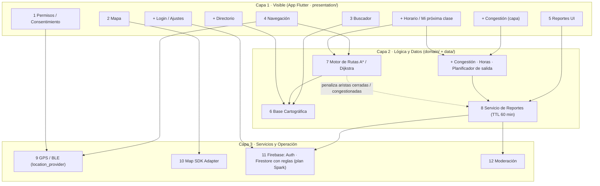
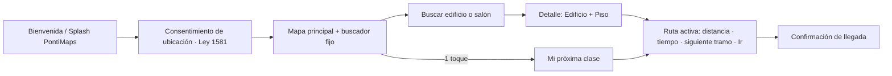
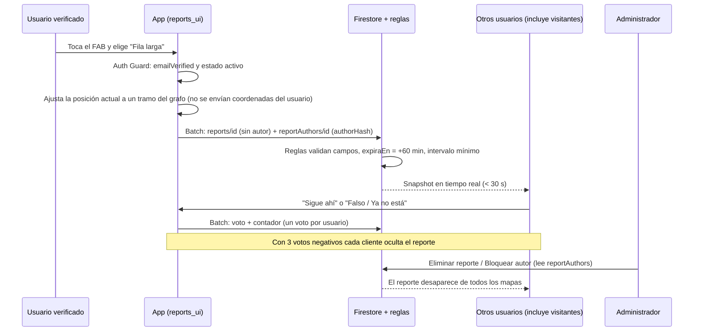
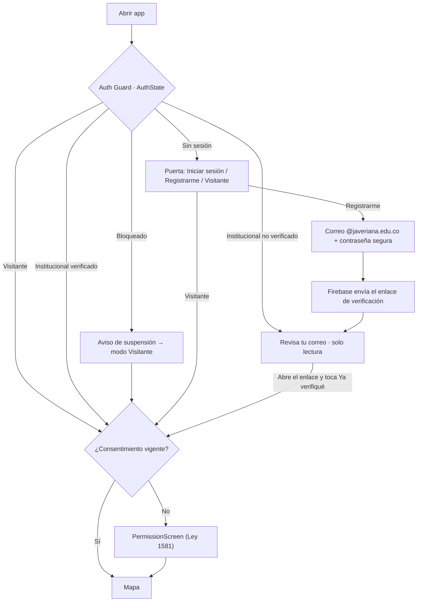
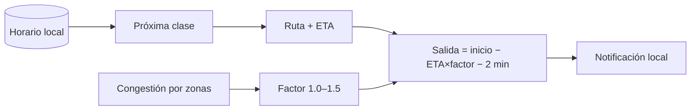

# PontiMaps — Documento de Requerimientos (`REQUIREMENTS.md`)

> **Versión:** 0.3 (sincronizado con `USER_PATHS.md` y `ARCHITECTURE.md`; backend en plan Spark) · **Producto:** PontiMaps (marca gráfica: *La Pontimaps*) · **Stack:** Flutter (Dart) + Firebase (Auth + Firestore)
> **Equipo:** Juan Pablo Morea, Juan Pablo Gómez, Santiago Corredor, Iván Wright · **Asignatura:** Innovación y Diseño de Producto, 2026-2
> **Nombre único:** *PontiMaps*. Los nombres "JaveRutas" y "JaveMaps" están descartados (residuos corregidos en el repositorio).

---

## 0. Estado actual del repositorio (punto de partida)

### 0.1 Qué existe hoy

El repo (`main`, un solo commit `chore: estructura base de pontimaps en Flutter`) es un **andamio base**:

| Elemento | Estado |
| :--- | :--- |
| `lib/main.dart` | Base inicial con título `PontiMaps` y color semilla `#002D72` (pendiente conectar `PontiMapsTheme` y pantallas). |
| `lib/core/utils`, `lib/models`, `lib/domain/routing` | **Dominio puro implementado y probado** (TADs, A\*, `authorHash`; ver `ARCHITECTURE.md`). `lib/data` y `lib/presentation` siguen vacíos (`.gitkeep`). |
| `pubspec.yaml` | Declara `flutter_riverpod`, `go_router`, `flutter_map`, `latlong2`, `geolocator`, `permission_handler`, `firebase_core`, `firebase_auth`, `cloud_firestore`, `crypto`. `cloud_functions` sigue declarado pero **no se usa en el MVP** (plan Spark, sin funciones). |
| `.env.example`, `dart_defines.json` | Plantillas de configuración con `FIREBASE_PROJECT_ID=pontimaps-puj` y `USE_OFFLINE_FALLBACK=true`; `.env` y `dart_defines.json` están en `.gitignore`. |
| `test/widget_test.dart` | Test base inicial (se actualizará al reemplazar `main.dart`). |
| `android/ ios/ web/ linux/ macos/ windows/` | Plataformas configuradas bajo la organización `co.edu.javeriana` y etiqueta `PontiMaps`. |

### 0.2 Hallazgos revisados y pendientes antes de programar

1. **Identificador de paquete `co.edu.javeriana` (Resuelto):** Se migró `com.example` a `co.edu.javeriana.pontimaps_app` (`applicationId`, `namespace` y `MainActivity.kt` en Android; `co.edu.javeriana.pontimapsApp` en iOS/macOS; `co.edu.javeriana.pontimaps_app` en Linux/Windows) y se fijó el nombre visible `PontiMaps`.
2. **ID de proyecto Firebase `pontimaps-puj` (Resuelto):** `.env`, `.env.example` y `dart_defines.json` apuntan ahora a `FIREBASE_PROJECT_ID=pontimaps-puj`.
3. **Dependencias que aún faltan** para lo nuevo (§2): `firebase_app_check` (F2), un almacenamiento local (p. ej. `shared_preferences` + `drift` o `isar`), `flutter_local_notifications`, `flutter_secure_storage`, `url_launcher`.
4. **Mapa:** `flutter_map` + OpenStreetMap es válido para demo, pero los servidores públicos de OSM **no admiten uso intensivo en producción**. Para Corte 3 / piloto: proveedor con llave (Mapbox/MapTiler) o tiles propios. El `map_sdk_adapter` (módulo 10) debe aislar esta decisión.
5. **Plan Spark (cerrado):** el backend del MVP usa solo Firebase Auth y Cloud Firestore con Security Rules; no hay Cloud Functions. Consecuencias y plan B en §4.4. **Ubicación compartida (cerrado):** Fase 2 y sin persistencia (§2.8), alineada con la Regla 4.

---

## 1. Visión general y alcance

### 1.1 Visión

PontiMaps es "el Waze del Campus Javeriano": navegación **peatonal** hacia edificios y salones de la Pontificia Universidad Javeriana (Bogotá), con reportes colaborativos en tiempo real (cierres, filas, alta afluencia), un mapa de congestión que respeta la privacidad y herramientas de rutina académica (directorio de servicios y "Mi próxima clase").

### 1.2 Usuarios

| Perfil | Descripción | Acceso |
| :--- | :--- | :--- |
| Estudiante | Usuario principal. Usa horario, rutas, reportes. | Cuenta institucional |
| Profesor | Igual que estudiante; puede ver salones/aulas. | Cuenta institucional |
| Personal administrativo | Igual; en Fase 2 podrá publicar avisos oficiales de cierre. | Cuenta institucional |
| Invitado (visitante) | Solo lectura: mapa, buscador, rutas y reportes activos. Sin escrituras (§RF-AUT-05). | Sin cuenta y **sin sesión en la nube** |
| Administrador / moderador | Un usuario institucional con `rol: admin` (asignado solo desde la consola de Firebase). Ve reportes activos, los elimina, publica alertas oficiales, bloquea autores y gestiona usuarios. | Cuenta institucional verificada |
| Bloqueado | Cuenta con `estado: bloqueado`. Pierde la escritura y queda degradado a Visitante. | — |

### 1.3 Dentro del alcance

Búsqueda de edificios/salones, ruta peatonal, GPS en vivo, reportes comunitarios con moderación, mapa de congestión, directorio de servicios, horario académico, autenticación institucional, cumplimiento Ley 1581 de 2012.

### 1.4 Fuera del alcance (explícito)

- Navegación **dentro** de edificios paso a paso (solo Edificio + Piso; BLE queda como abstracción preparada, ver RF-NAV-08).
  - *Aclaración:* sí se informa el **acceso vertical** del edificio destino (hay ascensor, hay varios, o el piso solo se alcanza por escaleras internas; `Edificio.accesoVertical`, fuente `docs/edificios_ascensores.json`). Es un dato del edificio mostrado junto a "Edificio X · Piso Y", no una ruta interior: la navegación termina en la entrada.
- Rutas vehiculares o transporte público.
- Integración oficial con el sistema académico de la Universidad (Banner/portal): el horario se ingresa o importa manualmente.
- Pagos o pedidos a comercios aliados.
- Chat o red social.

### 1.5 Leyenda de prioridad

| Etiqueta | Significado |
| :--- | :--- |
| **MVP-C2** | Imprescindible para la sustentación del Corte 2 (funciona 100 % offline con datos semilla). |
| **MVP-C3** | Imprescindible para el Corte 3 (requiere Firebase configurado). |
| **F2** | Fase 2 / escalabilidad; se especifica ahora pero no se construye en los cortes. |

---

## 2. Requerimientos Funcionales (RF)

Convención de IDs: `RF-<ÁREA>-<NN>`. Áreas: `PER` permisos, `MAP` mapa, `BUS` búsqueda, `NAV` navegación, `REP` reportes, `AUT` autenticación, `CON` congestión, `DIR` directorio, `HOR` horario, `UBI` ubicación compartida.

### 2.1 Permisos y consentimiento (módulo 1 · Ley 1581)

| ID | Requerimiento | Criterio de aceptación | Prioridad |
| :--- | :--- | :--- | :--- |
| RF-PER-01 | Pantalla propia de consentimiento antes de cualquier permiso de GPS. | `Geolocator.requestPermission()` solo se invoca desde `PermissionScreen` tras aceptar explícitamente; test que falla si se invoca antes. | MVP-C2 |
| RF-PER-02 | La pantalla explica finalidad, qué se procesa (en memoria), qué **no** se guarda y enlaza la política de tratamiento. | Texto revisado contra el §3.4; versión del texto guardada (`consentVersion`). | MVP-C2 |
| RF-PER-03 | Consentimientos **separados**: (a) uso de GPS para navegar, (b) aportar presencia anónima al mapa de congestión, (c) compartir ubicación con contactos. (b) y (c) **desactivados por defecto**. | Cada uno tiene su propio interruptor; rechazar (b)/(c) no limita (a). | MVP-C2 (a), F2 (b, c) |
| RF-PER-04 | Interruptor accesible en Ajustes para revocar/pausar el GPS en cualquier momento. | Al revocar, el stream de posición se cancela en < 1 s y la app sigue funcionando en modo "sin ubicación" (búsqueda y vista de ruta desde un punto elegido). | MVP-C2 |
| RF-PER-05 | Si el usuario niega el permiso del sistema, la app degrada con elegancia. | Sin GPS: se puede buscar y ver ruta desde un origen elegido manualmente; sin pantallas bloqueantes. | MVP-C2 |

### 2.2 Mapa (módulo 2) y Base Cartográfica (módulo 6)

| ID | Requerimiento | Criterio de aceptación | Prioridad |
| :--- | :--- | :--- | :--- |
| RF-MAP-01 | Render del campus con marcadores/polígonos de edificios, posición del usuario y reportes activos. | Mapa visible en < 3 s en dispositivo de gama media; marcadores etiquetados con texto (contraste ≥ 4,5:1). | MVP-C2 |
| RF-MAP-02 | Dataset semilla local (`campus_cartography.dart`) con edificios emblemáticos (Ed. 2, 11, 51, 67, Biblioteca General, Cafetería Central), salones con piso y grafo peatonal **conexo**. | Test unitario: grafo conexo; todo edificio tiene ≥ 1 nodo de entrada; todo salón referencia edificio y piso válidos. | MVP-C2 |
| RF-MAP-03 | Cobertura del 100 % de edificios de clase en el catálogo. | Checklist firmada contra el listado oficial de edificios de clase; el equipo registra la fuente. | MVP-C3 |
| RF-MAP-04 | El catálogo puede sincronizarse desde Firestore sin romper el modo offline. | Sin red, se usa el semilla; con red, versión del catálogo (`catalogVersion`) más nueva reemplaza al semilla. | MVP-C3 |
| RF-MAP-05 | Atribución del proveedor de tiles visible. | Visible en pantalla del mapa. | MVP-C2 |

> **Nota de riesgo:** las coordenadas de los edificios y aristas peatonales deben **levantarse en campo** (o validarse con OSM). Los datos semilla iniciales serán aproximados y deben marcarse como tales hasta verificarlos.

### 2.3 Buscador (módulo 3)

| ID | Requerimiento | Criterio de aceptación | Prioridad |
| :--- | :--- | :--- | :--- |
| RF-BUS-01 | Barra **fija superior** (nunca en Drawer) para buscar por nombre o número de edificio. | Desde el mapa, ver el edificio en ≤ 3 toques (abrir barra → escribir/elegir → resultado). | MVP-C2 |
| RF-BUS-02 | Búsqueda por código de salón; el resultado muestra siempre **Edificio + Piso**. | Ningún resultado de salón se renderiza sin ambos campos (test de widget). | MVP-C2 |
| RF-BUS-03 | Búsqueda tolerante: sin tildes, mayúsculas indiferentes, número o nombre parcial ("gerardo arango", "51", "ed 51"). | Tabla de casos de prueba ≥ 20 consultas, 100 % pasan. | MVP-C2 |
| RF-BUS-04 | El buscador también devuelve lugares del directorio (RF-DIR). | Resultados agrupados: Edificios · Salones · Servicios. | MVP-C3 |
| RF-BUS-05 | Tarjeta de detalle con nombre, Edificio + Piso y botón **"Ir"** (≥ 48×48 dp). | Visible sin scroll a 360×800 dp y texto 200 %. | MVP-C2 |

### 2.4 Navegación (módulo 4) y Motor de Rutas (módulo 7)

| ID | Requerimiento | Criterio de aceptación | Prioridad |
| :--- | :--- | :--- | :--- |
| RF-NAV-01 | Ruta peatonal óptima con A\* (o Dijkstra) sobre el grafo del campus. | Cálculo < 2 s en el peor caso del grafo, medido en dispositivo de gama media (benchmark automatizado). | MVP-C2 |
| RF-NAV-02 | La ruta **evita tramos cerrados** (reportes de cierre activos y cierres oficiales). | Test: con arista cerrada, la ruta alternativa no la contiene; si no hay alternativa, se informa "sin ruta" con motivo. | MVP-C2 |
| RF-NAV-03 | Polilínea en el mapa y tarjeta inferior con **distancia (m)**, **tiempo (min)**, **siguiente tramo** y botón **"Ir"**. | Los 4 elementos visibles simultáneamente. | MVP-C2 |
| RF-NAV-04 | Tiempo estimado con error ±1 min. | Validación en campo con ≥ 10 recorridos; ver RNF-REN-04 (calibración de velocidad). | MVP-C3 |
| RF-NAV-05 | Posición en vivo ≤ 5 m de precisión, refresco cada 1 s. | Medido con log en dispositivo real al aire libre; ver riesgo de batería en RNF-REN-05. | MVP-C2 |
| RF-NAV-06 | Re-cálculo automático si el usuario se desvía > 25 m del trazado o aparece un cierre en la ruta. | Re-cálculo < 2 s; notificación visual no intrusiva. | MVP-C3 |
| RF-NAV-07 | Confirmación de llegada (proximidad al nodo de entrada ≤ 15 m). | Pantalla de llegada con Edificio + Piso destino. | MVP-C2 |
| RF-NAV-08 | `location_provider` expone una interfaz abstracta con implementación GPS y un *stub* BLE. | La UI depende de la interfaz, no de `geolocator`. | MVP-C2 |
| RF-NAV-09 | Flujo `Abrir → Destino → Ir` en **3 toques** con **un solo botón "Ir"** (toque 1: barra fija superior; toque 2: edificio o salón; toque 3: "Ir", que abre la ruta ya en curso). | Prueba de usabilidad con ≥ 5 participantes nuevos; mediana **< 30 s medida desde el ingreso efectivo al mapa** (post-login o modo visitante) hasta iniciar la ruta, sin ayuda. El registro y la verificación del correo no cuentan. | MVP-C3 |

### 2.5 Reportes colaborativos (módulos 5, 8, 12)

| ID | Requerimiento | Criterio de aceptación | Prioridad |
| :--- | :--- | :--- | :--- |
| RF-REP-01 | FAB que abre modal con tres opciones, cada una con **icono + etiqueta de texto**: `Cierre de paso`, `Fila larga`, `Alta afluencia`. | Botones ≥ 48×48 dp; test de widget verifica que cada icono tiene `Text` visible. | MVP-C2 |
| RF-REP-02 | Publicación y aparición en el mapa de todos los usuarios (incluidos visitantes) en < 30 s. | Medición extremo a extremo (publicar → snapshot en otro dispositivo) p95 < 30 s. | MVP-C3 |
| RF-REP-03 | Expiración automática: un reporte sin confirmaciones expira **exactamente a los 60 min**. | Test con reloj inyectable: a t=59:59 activo, a t=60:00 inactivo. **El cliente filtra por `expiraEn`** (autoritativo); el TTL de Firestore solo recoge los vencidos. | MVP-C2 |
| RF-REP-04 | Calificación comunitaria con dos opciones: **"Sigue ahí"** (confirma) y **"Falso / Ya no está"** (voto negativo). Un voto por usuario y reporte; el autor no vota el suyo. | Segundo voto del mismo usuario se rechaza (en memoria y por reglas). Solo cuentas con `emailVerified == true` y `estado == activo`; el visitante ve los botones con candado. | MVP-C2 (memoria) / MVP-C3 (reglas) |
| RF-REP-05 | Moderación comunitaria: un reporte con **≥ 3 votos negativos se oculta automáticamente** del mapa. Cada confirmación extiende la vida +30 min (tope 180 min desde la creación). | `ReporteComunidad.estaVigente` devuelve `false` con 3 negativos aunque tenga confirmaciones; un reporte oculto no se revive. Parámetros en `config/appConfig`, no en código. | MVP-C2 |
| RF-REP-06 | Anti-spam: intervalo mínimo entre reportes por cuenta (p. ej. 1 por minuto) y tope diario, **validados en las reglas** con `request.time`; deduplicación por tramo de mejor esfuerzo en el cliente (mismo tipo en el mismo tramo en 10 min → se ofrece confirmar el existente). | Pruebas con el emulador de reglas: el segundo reporte dentro del intervalo se rechaza. | MVP-C3 |
| RF-REP-07 | **Anonimato visual total:** ninguna pantalla ni lista pública muestra nombre, correo, `uid`, `authorHash` ni cualquier identidad del autor de un reporte. | Revisión de todas las pantallas y de `toString`/`toMap` públicos; test que verifica que la vista pública no contiene el `authorHash`. | MVP-C2 |
| RF-REP-08 | **Seudonimización con `authorHash`:** cada reporte tiene un `authorHash` (SHA-256 irreversible del `uid`, `calcularAuthorHash`) guardado **fuera del documento público** (`reportAuthors/{reportId}`), legible solo por el administrador y por el propio autor. No hay coordenadas ni historial de recorrido asociados. | El documento público del reporte no contiene el hash; las reglas niegan su lectura a otros usuarios; el hash coincide con `UsuarioPerfil.authorHash`. | MVP-C3 |
| RF-REP-09 | Modo local en memoria si Firebase no está configurado: crear, votar y expirar a 60 min sin excepciones. | Con `USE_OFFLINE_FALLBACK=true` el flujo completo funciona sin red. | MVP-C2 |
| RF-REP-10 | Los reportes alimentan el peso de aristas del motor de rutas y el mapa de congestión. | Cierre → arista bloqueada; fila/afluencia → penalización (RF-CON-02). | MVP-C3 |
| RF-REP-11 | **Moderación del administrador:** ver la lista de reportes activos, **eliminarlos al instante**, publicar **alertas oficiales fijas** y usar **"Bloquear autor"** sobre un reporte falso (suspende la cuenta cuyo `authorHash` coincide). | Eliminar retira el reporte de todos los clientes en < 30 s; "Bloquear autor" pone `estado = bloqueado` a esa cuenta; solo `rol: admin`. | MVP-C3 |
| RF-REP-12 | El texto libre (`descripcionCorta`) **no se captura en el MVP**; el reporte solo lleva su tipo. | La UI no ofrece campo de texto; evita nombres propios y difamación. | MVP-C2 |

### 2.6 Autenticación y seguridad institucional (nuevo)

Todo el backend del MVP corre en el **plan gratuito Spark**: Firebase Auth + Cloud Firestore con Security Rules, **sin Cloud Functions**.

| ID | Requerimiento | Criterio de aceptación | Prioridad |
| :--- | :--- | :--- | :--- |
| RF-AUT-01 | Registro e inicio de sesión con correo `@javeriana.edu.co` y contraseña mediante Firebase Auth. | El dominio se valida en la UI **y** en las reglas (`request.auth.token.email.matches(...)`). Spark no permite bloquear el registro por dominio (no hay *blocking functions*): una cuenta de otro dominio puede existir en Auth, pero no puede leer ni escribir nada privado. | MVP-C3 |
| RF-AUT-02 | **Verificación de correo con el enlace nativo de Firebase Auth** (`user.sendEmailVerification()`). Sin códigos OTP y sin Cloud Functions de correo. | Tras registrarse se muestra "Revisa tu correo" con **Reenviar enlace** (espera de 60 s en el cliente), **Ya verifiqué** (`reload()` + `getIdToken(true)`) y revisión automática al volver a la app. Hasta `emailVerified == true` la cuenta es de solo lectura. | MVP-C3 |
| RF-AUT-03 | **Política de contraseña** (estilo Google): mínimo 8 caracteres con al menos 1 mayúscula, 1 minúscula, 1 número y 1 símbolo especial; sin espacios al inicio ni al final; no contiene la parte local del correo; indicador de fortaleza en tiempo real (texto, no solo color). | Se valida en el cliente (en Spark no hay forma de imponerla en el servidor con funciones); si la consola de Firebase ofrece política de contraseñas para el proyecto, también se activa allí. | MVP-C3 |
| RF-AUT-04 | **Auth Guard transversal:** todo flujo evalúa primero `AuthState`: `Institucional Verificado`, `Visitante`, `Bloqueado`, `Sin sesión` (y `Institucional no verificado`, de solo lectura). Las **escrituras** (crear/calificar reportes, guardar horario, compartir ubicación en Fase 2) permanecen bloqueadas hasta `emailVerified == true` y `estado == activo`. | `UsuarioPerfil.puedeEscribir` es la única fuente en el cliente; las reglas repiten la condición en el servidor. | MVP-C3 |
| RF-AUT-05 | **Visitante sin sesión en la nube:** "Continuar como Visitante" es solo lectura, **no crea usuario en Firebase Auth ni registros** (no se usa `signInAnonymously`). Una acción de escritura abre un modal bloqueante con acceso a **Iniciar sesión / Registrarme**. | En la consola de Firebase, el número de usuarios de Auth no aumenta al usar el modo visitante. Las lecturas públicas están protegidas con App Check cuando se active. | MVP-C2 |
| RF-AUT-06 | Tipo de usuario (`estudiante`, `profesor`, `administrativo`) elegido al registrarse, **informativo** en el MVP. El rol `admin` lo asigna **únicamente el equipo**, editando `users/{uid}.rol` en la consola de Firebase. | Está **prohibido el auto-registro de administradores**: `UsuarioPerfil.registro` rechaza `admin`, la UI no lo ofrece y las reglas impiden que un cliente escriba `rol: admin`. | MVP-C3 |
| RF-AUT-07 | **Estado de cuenta** `activo` / `bloqueado`, gestionado por el administrador. Un usuario bloqueado pierde los permisos de escritura y queda degradado **automáticamente a modo Visitante** (solo lectura). | La app escucha su propio `users/{uid}`: al pasar a `bloqueado` cierra sesión al instante y muestra un aviso. Las reglas rechazan sus escrituras desde ese momento (verifican `estado == activo`). | MVP-C3 |
| RF-AUT-08 | Cierre de sesión y **eliminación de cuenta y datos** desde Ajustes (derecho de supresión). | El cliente reautentica, borra `users/{uid}` y sus registros de autoría y llama a `user.delete()`. Los reportes públicos ya son anónimos y vencen solos. | MVP-C3 |
| RF-AUT-09 | Firebase App Check (Play Integrity / App Attest) activo para proteger las lecturas públicas y las escrituras. | Solicitudes sin token válido se rechazan en producción. | F2 |

> **Cierre de D-1:** la restricción de dominio se impone con reglas + verificación de correo (no hay Identity Platform ni funciones). Una cuenta con otro dominio no supera `email.matches` y no puede usar nada privado.
> **Entregabilidad:** el correo de verificación sale del dominio de Firebase y puede caer en spam en cuentas institucionales. Hay que probar el envío real a `@javeriana.edu.co` y personalizar la plantilla en español en la consola antes del piloto.

### 2.7 Mapa de congestión y presencia (nuevo)

| ID | Requerimiento | Criterio de aceptación | Prioridad |
| :--- | :--- | :--- | :--- |
| RF-CON-01 | Capa de mapa de calor por **zonas** del campus con niveles `Baja / Media / Alta` (color **y** etiqueta/patrón, no solo color). | Leyenda con texto; apto para daltonismo; contraste de etiquetas ≥ 4,5:1. | MVP-C3 |
| RF-CON-02 | Nivel de congestión por zona calculado desde reportes activos (fila/afluencia) con decaimiento temporal. | Función pura `congestionLevel(zone, reports, now)` con tests; un reporte de 59 min pesa menos que uno de 1 min. | MVP-C3 |
| RF-CON-03 | Densidad agregada de usuarios activos por zona (presencia anónima) combinada con RF-CON-02. | **Requiere rediseño** (RNF-PRI-09): sin Cloud Functions no se garantiza el anonimato mínimo (k ≥ 5) ni se evita el inflado de contadores. En el MVP la congestión sale solo de reportes. | F2 |
| RF-CON-04 | La contribución de presencia es **opt-in** (RF-PER-03b), con granularidad de **zona** (no coordenadas) y sin identificador; solo `Institucional Verificado`. | El cliente envía `zoneId`, no lat/lng; no se asocia a ningún `uid` ni `authorHash`. | F2 |
| RF-CON-05 | El factor de congestión alimenta ETA y alertas de traslado (RF-HOR-05). | `factorCongestión ∈ [1.0, 1.5]` por zona atravesada. | MVP-C3 |

### 2.8 Ubicación compartida opt-in (nuevo)

**Fase 2 — fuera del MVP.** Privacidad por diseño: **cero base de datos, solo memoria RAM**.

| ID | Requerimiento | Criterio de aceptación | Prioridad |
| :--- | :--- | :--- | :--- |
| RF-UBI-01 | El usuario inicia una sesión de ubicación compartida **temporal** (15 min / 1 h / hasta llegar) con compañeros verificados. Apagada por defecto. | Cada sesión requiere confirmación explícita y tiene fecha de fin obligatoria. Solo `Institucional Verificado` activo (no visitante, no bloqueado, no sin verificar). | F2 |
| RF-UBI-02 | Solo participantes con cuenta institucional verificada que **aceptaron** la solicitud intercambian datos. | Hasta que el compañero acepta no fluye ninguna posición. | F2 |
| RF-UBI-03 | **Sin persistencia:** la ubicación ni su hora se guardan **nunca** en Firestore ni en almacenamiento local. Viaja por un **canal efímero cifrado en tránsito** y vive **solo en la RAM** de la app del compañero autorizado. | Auditoría de código: no existe escritura de posiciones en Firestore, `SharedPreferences`, archivos ni bases locales. | F2 |
| RF-UBI-04 | Si el emisor apaga la opción, cierra la app o pierde la conexión, la variable en RAM del receptor se limpia a `null` y la pantalla muestra **"Ubicación no disponible en este momento"**. | Prueba con dos dispositivos: al cortar al emisor, el receptor limpia el valor en un tiempo corto definido (objetivo ≤ 10 s). | F2 |
| RF-UBI-05 | Indicador persistente mientras se comparte y botón para dejar de compartir en **1 toque**. | Visible en todas las pantallas. | F2 |

> **Riesgo técnico por validar antes de construir:** un canal sin servidor de datos ni base de datos exige conexión directa entre teléfonos (p. ej. *WebRTC data channel*, cifrado por DTLS) con una señalización que solo intercambie el protocolo de conexión —**sin coordenadas**— y, para atravesar redes móviles, probablemente un servidor TURN, que el plan Spark no ofrece. Si no resulta viable sin infraestructura propia, la función no se construye. Como no se almacena nada, **tampoco el administrador puede ver ubicaciones**.

### 2.9 Directorio de negocios y servicios (nuevo)

| ID | Requerimiento | Criterio de aceptación | Prioridad |
| :--- | :--- | :--- | :--- |
| RF-DIR-01 | Catálogo de cafeterías, papelerías, puntos de atención, servicios universitarios y comercios aliados cercanos, con categoría, ubicación (edificio/piso o coordenada), contacto y horario. | ≥ 10 lugares semilla en MVP-C2 desde JSON local. | MVP-C2 |
| RF-DIR-02 | Aparecen como marcadores filtrables por categoría y como resultados del buscador. | Filtro por categoría en ≤ 2 toques. | MVP-C3 |
| RF-DIR-03 | Estado **Abierto / Cerrado / Cierra pronto (< 30 min)** calculado localmente desde el horario semanal y excepciones (festivos). | Función pura con tests (incluye cruce de medianoche y zona horaria `America/Bogota`). | MVP-C2 |
| RF-DIR-04 | **Nivel de fila reportado** por lugar (Sin fila / Moderada / Larga) a partir de reportes `Fila larga` anclados a `placeId`, con la misma expiración de 60 min. | Si no hay reporte vigente se muestra "Sin datos recientes", no "Sin fila". | MVP-C3 |
| RF-DIR-05 | Comercios aliados marcados como tales; el contenido comercial no altera el orden de ruta. | Etiqueta visible "Aliado". | F2 |
| RF-DIR-06 | Alta/edición de lugares por administradores (consola de Firebase o vista de gestión). | Solo `users/{uid}.rol == admin` (asignado desde la consola) puede escribir. | F2 |

### 2.10 Horario académico y "Mi próxima clase" (nuevo)

| ID | Requerimiento | Criterio de aceptación | Prioridad |
| :--- | :--- | :--- | :--- |
| RF-HOR-01 | Registro manual de clases: materia, días, hora inicio/fin, edificio, salón. **Requiere cuenta institucional verificada** (un visitante ve el control con candado). | El salón se elige desde el catálogo (valida Edificio + Piso) y no se acepta texto libre inexistente. | MVP-C2 |
| RF-HOR-02 | El horario se guarda **localmente en el dispositivo** (privacidad por diseño), asociado a la cuenta que lo creó. | Funciona sin red; no se sube a Firestore en MVP; no se muestra a otra cuenta. | MVP-C2 |
| RF-HOR-03 | Importación de horario desde archivo (`.ics` o CSV con plantilla). | Importación con vista previa y reporte de filas inválidas. | F2 |
| RF-HOR-04 | Acceso de **1 toque** desde la pantalla principal a "Mi próxima clase", que inicia la ruta hacia su salón. | Desde el mapa: 1 toque → vista de ruta con distancia, tiempo y "Ir". | MVP-C2 |
| RF-HOR-05 | Alerta de hora de salida: `salida = inicio − (ETA × factorCongestión) − margen(2 min)`; notificación local "Sal en N min a Ed. X, Piso Y". | Notificación se programa/reprograma al cambiar congestión o ETA; sin cuenta ni servidor. | MVP-C3 |
| RF-HOR-06 | Definición de "próxima clase": primera clase cuyo inicio ≥ ahora − 10 min (tolerancia de tardanza), considerando día de la semana. | Tests con casos límite (domingo, fin de semestre, sin clases). | MVP-C2 |
| RF-HOR-07 | Sincronización opcional del horario entre dispositivos (cuenta). | Cifrado y reglas `users/{uid}/schedule` solo-dueño. | F2 |

---

## 3. Requerimientos No Funcionales (RNF)

### 3.1 Rendimiento y batería

| ID | Requerimiento | Métrica / valor meta | Cómo se verifica |
| :--- | :--- | :--- | :--- |
| RNF-REN-01 | Cálculo de ruta | < 2 s | Benchmark en dispositivo de gama media, grafo completo |
| RNF-REN-02 | Latencia de propagación de reportes | < 30 s (p95) | Dos dispositivos, medición de punta a punta |
| RNF-REN-03 | Arranque en frío hasta mapa interactivo | < 3 s (gama media) | Profile mode |
| RNF-REN-04 | Error del tiempo estimado | ± 1 min | Recorridos reales; calibrar `walkingSpeed` en `appConfig` (punto de partida ≈ 1,25 m/s) |
| RNF-REN-05 | Consumo de batería en navegación activa | ≤ 5 % por 15 min | Medición en dispositivo real (pantalla encendida). **Riesgo:** GPS a 1 Hz + pantalla encendida puede excederlo. Mitigaciones: solo en primer plano, `distanceFilter` adaptativo, tiles en caché, sin animaciones continuas, cancelar el stream al pausar la app |
| RNF-REN-06 | Frecuencia/precisión GPS | cada 1 s, ≤ 5 m | Log de `Position.accuracy` |
| RNF-ESC-01 | **Escalabilidad de visitantes:** soportar **900+ visitantes concurrentes** (jornadas de inducción o eventos) **sin crear sesiones en Firebase Auth** | 900 clientes simultáneos con p95 de propagación de reportes < 30 s; 0 usuarios nuevos en Auth | Prueba de carga con clientes simulados contra un proyecto de pruebas (no producción) |
| RNF-ESC-02 | El catálogo, el grafo y el cálculo de rutas son **locales** (0 lecturas de Firestore para buscar y rutear). Los visitantes solo leen reportes activos y alertas oficiales con **un solo *listener* acotado** (`expiraEn > ahora`, con `limit`) | ≤ 30 lecturas de Firestore por visitante en una sesión típica de 30 min | Contador de lecturas en pruebas |
| RNF-ESC-03 | Presupuesto del plan Spark | 900 visitantes × 30 lecturas ≈ 27.000 lecturas, por debajo de la cuota gratuita diaria de lecturas (50.000 al redactar este documento; **verificar el valor vigente**, D-18), con margen para los usuarios institucionales | Revisión de la consola de uso |
| RNF-ESC-04 | Degradación elegante si se agota la cuota o falla la red | La app sigue con catálogo y rutas locales y avisa "Reportes no disponibles por alta demanda" | Prueba simulando el error de cuota |

### 3.2 Accesibilidad y UI (WCAG 2.2)

| ID | Requerimiento | Valor |
| :--- | :--- | :--- |
| RNF-UI-01 | Marco base | 360 × 800 dp; márgenes laterales 16 dp; grilla de 4 columnas |
| RNF-UI-02 | Espaciado | Solo múltiplos de 8 dp (8, 16, 24, 32, 48); márgenes de pantalla 16 dp |
| RNF-UI-03 | Tipografía | Título 22 sp · Cuerpo 16 sp · Notas 12 sp; layout sin `RenderFlex overflowed` hasta 200 % (`TextScaler`) — WCAG 1.4.4 |
| RNF-UI-04 | Zonas táctiles | ≥ 48 × 48 dp en todo control interactivo — WCAG 2.5.8 / Material |
| RNF-UI-05 | Contraste | ≥ 4,5 : 1 para texto (incluidas etiquetas sobre el mapa) — WCAG 1.4.3. Azul `#002D72` con texto `#FFFFFF`; Dorado `#F2A900` con texto `#002D72` o `#121212`; fondo `#F8F9FA`; superficies `#FFFFFF` |
| RNF-UI-06 | Información no solo por color | Congestión y estado abierto/cerrado con texto/iconos además de color — WCAG 1.4.1 |
| RNF-UI-07 | Lectores de pantalla | `Semantics` en marcadores, FAB, tarjeta de ruta; orden de foco lógico |
| RNF-UI-08 | Idioma | Español (Colombia) por defecto; textos en archivos de localización (`l10n`) |
| RNF-UI-09 | Marca | Título `PontiMaps`; `PontiMapsTheme`; nunca "JaveRutas"/"JaveMaps" |

Verificación automatizada: *goldens* a 360×800 con escala 1,0 y 2,0; test de contraste sobre la paleta; test que recorre los widgets interactivos y comprueba tamaño ≥ 48×48.

### 3.3 Disponibilidad, resiliencia y calidad

| ID | Requerimiento |
| :--- | :--- |
| RNF-RES-01 | **Modo offline/fallback**: con `USE_OFFLINE_FALLBACK=true` o sin configuración de Firebase, todo el flujo principal y de reportes funciona con datos semilla y repositorio en memoria, sin excepciones visibles. |
| RNF-RES-02 | Caché de datos de Firestore habilitada (persistencia offline); la app abre y muestra el último estado conocido sin red. |
| RNF-RES-03 | Android 10+ (API 29) y iOS 15+; compilación Web ligera complementaria solo para validación. |
| RNF-CAL-01 | `flutter analyze` con **0 errores y 0 warnings** antes de cerrar cualquier tarea. |
| RNF-CAL-02 | Sin `// TODO` en funciones críticas (A\*, búsqueda de salones, filtro de expiración de 60 min). |
| RNF-CAL-03 | Cobertura de pruebas unitarias ≥ 80 % en `domain/` (enrutamiento, expiración, moderación, horario, estado abierto/cerrado, congestión). |
| RNF-SEG-GIT | Commits atómicos *Conventional Commits* (`feat:`, `fix:`, `ui:`, `refactor:`). Llaves solo vía `--dart-define` / `.env` ignorado; ninguna llave en `.dart`. |

### 3.4 Arquitectura de seguridad y privacidad (Ley 1581 de 2012)

**Principios de diseño:** minimización, finalidad, consentimiento previo e informado, y separación entre *dato de ubicación* e *identidad*.

| ID | Requerimiento | Implementación |
| :--- | :--- | :--- |
| RNF-PRI-01 | Autorización previa, expresa e informada | `PermissionScreen` (RF-PER-01..03), con versión del texto y fecha de aceptación guardadas (en la cuenta, para usuarios; en el dispositivo, para visitantes). |
| RNF-PRI-02 | **Prohibido** almacenar historial de recorridos o coordenadas GPS vinculadas a identidad | La posición vive en memoria volátil; no se persiste en disco ni en Firestore. El esquema (§4) no contiene campos de posición ligados a `uid` ni a `authorHash`. |
| RNF-PRI-03 | Reportes: anonimato visual y seudonimización mínima | El documento público del reporte no tiene `uid`, nombre ni `authorHash`; se ancla a un tramo del grafo. La única referencia al autor es el `authorHash` (SHA-256 irreversible del `uid`) en un documento aparte (`reportAuthors/{reportId}`) que solo leen el administrador y el autor. Sirve para bloquear a quien publica reportes falsos. |
| RNF-PRI-04 | El `authorHash` es un dato personal seudonimizado | No es anónimo: quien conozca los `uid` (el administrador) puede recalcularlo. Debe declararse en el aviso de privacidad y en el consentimiento ("los reportes se asocian a tu cuenta, de forma no visible para otros, solo para moderación") y borrarse al vencer el reporte. |
| RNF-PRI-05 | Derechos del titular (conocer, actualizar, suprimir, revocar) | Ajustes: ver consentimientos, revocar y **eliminar cuenta** (RF-AUT-08). Canal de contacto del responsable en la pantalla de política. |
| RNF-PRI-06 | Política de tratamiento y aviso de privacidad | Enlazados desde `PermissionScreen`, el registro y Ajustes. Se identifica al responsable del tratamiento (por definir con la Universidad). |
| RNF-PRI-07 | Visitantes y menores | El visitante no genera ningún dato personal en la nube. Confirmar con asesoría si se permite a menores de edad (Art. 7 Ley 1581). |
| RNF-PRI-08 | Transferencia internacional | Elegir la ubicación de Firestore lo más cercana posible (p. ej. `southamerica-east1`) y declarar en la política que los datos se alojan en infraestructura de Google. |
| RNF-PRI-09 | Presencia agregada anónima (F2) | Requiere rediseño: sin funciones no se puede garantizar el anonimato mínimo (k ≥ 5) ni evitar el inflado de contadores. En el MVP la congestión sale solo de los reportes. |
| RNF-SEG-01 | Cifrado en tránsito | TLS (Firebase por defecto); sin tráfico HTTP en claro (`usesCleartextTraffic=false`, ATS en iOS). |
| RNF-SEG-02 | Cifrado en reposo | Cifrado por defecto de Google Cloud para Firestore; datos locales sensibles en `flutter_secure_storage`; el horario en la base local del sandbox de la app. |
| RNF-SEG-03 | Firestore Security Rules con "denegar por defecto" y **validación de cada escritura del cliente** | Sin Cloud Functions, las reglas son la única autoridad: validan tipo y campos del reporte, `expiraEn = request.time + 60 min`, `emailVerified`, `estado == activo`, rol, intervalos y votos únicos. Ver §4.3. |
| RNF-SEG-04 | Abuso | Intervalo mínimo entre reportes en reglas, App Check (F2), votos únicos, ocultamiento comunitario (≥ 3 negativos) y moderación del administrador. |
| RNF-SEG-05 | Secretos | Cero llaves en el repositorio; `.env` y `dart_defines.json` ignorados. Las llaves de mapas se restringen por *package name*/*bundle id*. |
| RNF-SEG-06 | Registro | Sin Cloud Functions no hay registros de servidor propios; la app no registra coordenadas, `uid` ni `authorHash` en logs. |
| RNF-SEG-07 | Administración | `rol: admin` solo se asigna desde la consola de Firebase; los clientes no pueden cambiar `rol`, `estado` ni `authorHash` de su perfil. |

> **Aviso:** este documento traduce la norma en requisitos técnicos, pero **no es asesoría legal**. Antes de un piloto con usuarios reales, la política de tratamiento y el registro (RNBD, si aplica) deben revisarse con la oficina jurídica de la Universidad.

> **D-2 (cerrada):** la ubicación compartida pasa a Fase 2 con arquitectura **sin persistencia** (solo RAM del receptor, canal efímero), de modo que **cumple la Regla 4** sin excepción: nunca se envían coordenadas a Firebase ligadas a un `userId`.

## 4. Modelo de datos preliminar (Firestore)

**Restricciones de diseño (plan Spark):** no hay Cloud Functions ni Admin SDK en producción. Los clientes escriben directamente en Firestore y **las reglas validan cada escritura**. Autorización por documentos: `users/{uid}.rol` y `users/{uid}.estado`.

### 4.1 Colecciones

| Colección | Documento / campos clave | Escritura | Expiración / anonimización |
| :--- | :--- | :--- | :--- |
| `config/appConfig` | `walkingSpeedMps`, `reportTtlMinutes=60`, `confirmExtensionMinutes=30`, `reportMaxLifeMinutes=180`, `hideAfterNegatives=3`, `minSecondsBetweenReports`, `catalogVersion` | Solo la consola (equipo) | — |
| `buildings`, `graph/*`, `places`, `zones` (F2, RF-MAP-04) | Catálogo y grafo. En el MVP el catálogo es **local** (cero lecturas) | Solo la consola | — |
| `reports/{reportId}` | **Público.** `tipo` (`cierre`/`fila`/`altaAfluencia`), `idAristaAfectada`, `lat`, `lng` (del incidente), `creadoEn`, `expiraEn`, `confirmaciones`, `reportesNegativos`. **Sin `uid`, sin `authorHash`, sin texto libre** | Crea: cuenta verificada y activa (reglas). Actualiza solo contadores y `expiraEn`, junto con un voto. Borra: administrador, o cualquiera con cuenta verificada si `expiraEn` ya venció | `expiraEn = creadoEn + 60 min`; política TTL de Firestore sobre `expiraEn` si el plan lo permite (puede tardar hasta ~24 h; el cliente **siempre** filtra por `expiraEn`) |
| `reportAuthors/{reportId}` | `authorHash`, `borrarEn` | Crea: el autor, en el mismo *batch* que el reporte, con su propio `authorHash`. Sin actualizaciones | **Lectura solo del administrador y del autor.** Se elimina con el reporte (TTL sobre `borrarEn = expiraEn + margen`) |
| `reports/{id}/votes/{authorHashVotante}` | `valor` (+1 confirma / −1 "Falso / Ya no está"), `en` | Solo creación, en el mismo *batch* que el incremento del contador (las reglas lo validan con `getAfter`). El id impide un segundo voto | Lectura solo del administrador. Se elimina con el reporte |
| `officialAlerts/{alertId}` | `idAristaAfectada`/zona, `tipo`, `mensaje`, `desde`, `hasta?` | Solo administrador | Fijas: no expiran a los 60 min; terminan al levantarse o en `hasta` |
| `users/{uid}` | `rol` (`estudiante`/`profesor`/`administrativo`/`admin`), `estado` (`activo`/`bloqueado`), `authorHash`, `createdAt`, `consent{version, acceptedAt}`, `prefs`, `ultimoReporteEn` | Crea: el dueño con `rol` no admin y `estado = activo`. Actualiza: el dueño solo `prefs`/`consent`/`ultimoReporteEn`; el administrador solo `estado` y nunca el de un administrador ni el propio | Se elimina con la cuenta. **Sin campos de ubicación.** `rol: admin` solo desde la consola |
| `adminActions/{id}` | Quién, a quién, qué, cuándo, motivo | Solo administrador (mismo *batch* de la acción) | Bitácora de mejor esfuerzo: la escribe el cliente del administrador, así que no es a prueba de un administrador malintencionado |

**No existen** en el MVP: `_otp`, `_rateLimits`, `_presence`, `shares`, `zoneStats` por presencia (ver RNF-PRI-09 y §2.8). El **horario** vive en almacenamiento local (RF-HOR-02).

### 4.2 Reglas de expiración, moderación y anonimización

1. Un reporte nuevo nace con `expiraEn = creadoEn + 60 min`.
2. Cada confirmación recalcula `expiraEn = min(creadoEn + 180 min, expiraEn + 30 min)`.
3. Con `reportesNegativos >= 3` el reporte **se oculta**: cada cliente lo decide con `ReporteComunidad.estaVigente`, sin necesidad de ningún proceso de servidor.
4. El **cliente** considera activo un reporte solo si `now < expiraEn && reportesNegativos < 3`.
5. El administrador elimina un reporte borrando su documento: desaparece de todos los clientes por el *listener*.
6. **"Bloquear autor":** el administrador lee `reportAuthors/{id}`, busca `users` con ese `authorHash`, pone `estado = bloqueado` y, si quiere, borra el reporte; todo en un *batch*.
7. Anonimización por diseño: ningún documento **público** une identidad con posición, zona visitada o reporte creado. El único vínculo es el `authorHash`, privado y de vida corta.

### 4.3 Esquema de reglas (borrador por probar)

> Es un borrador de **intención**: debe implementarse y probarse con el *Firebase Emulator Suite* antes de desplegarse. Casos mínimos: visitante intenta escribir; cuenta no verificada intenta reportar; correo de otro dominio; usuario bloqueado intenta votar; cliente intenta cambiar su `rol`/`estado`/`authorHash`; segundo voto del mismo usuario; lectura de `reportAuthors` por otro usuario; reporte con `expiraEn` distinto de +60 min; reportes seguidos dentro del intervalo mínimo.

```
rules_version = '2';
service cloud.firestore {
  match /databases/{db}/documents {
    function signedIn()   { return request.auth != null; }
    function perfil()     { return get(/databases/$(db)/documents/users/$(request.auth.uid)).data; }
    function institucional() {
      return signedIn()
        && request.auth.token.email_verified == true
        && request.auth.token.email.matches('.*@javeriana[.]edu[.]co');
    }
    function activo()     { return institucional() && perfil().estado == 'activo'; }
    function esAdmin()    { return activo() && perfil().rol == 'admin'; }

    // Lectura pública (incluye visitantes sin sesión)
    match /reports/{id}        { allow read: if true;  /* create/update/delete: ver notas */ }
    match /officialAlerts/{id} { allow read: if true;  allow write: if esAdmin(); }
    match /config/{doc}        { allow read: if true;  allow write: if false; }

    // Autoría y votos: solo administrador (y el autor para su propio registro)
    match /reportAuthors/{id}  { allow read: if esAdmin() || (activo() && resource.data.authorHash == perfil().authorHash);
                                 allow create: if activo() && request.resource.data.authorHash == perfil().authorHash;
                                 allow update: if false;
                                 allow delete: if esAdmin() || (activo() && resource.data.authorHash == perfil().authorHash); }
    match /reports/{id}/votes/{v} { allow read: if esAdmin(); allow create: if activo(); allow update, delete: if false; }

    // Perfil: el dueño no puede tocar rol, estado ni authorHash; solo el admin cambia estado
    match /users/{uid} {
      allow read: if signedIn() && (request.auth.uid == uid || esAdmin());
      allow create: if institucional() && request.auth.uid == uid
                    && request.resource.data.rol in ['estudiante','profesor','administrativo']
                    && request.resource.data.estado == 'activo';
      allow update: if (signedIn() && request.auth.uid == uid && activo()
                        && !request.resource.data.diff(resource.data).affectedKeys().hasAny(['rol','estado','authorHash']))
                    || (esAdmin() && resource.data.rol != 'admin' && request.auth.uid != uid
                        && request.resource.data.diff(resource.data).affectedKeys().hasOnly(['estado']));
      allow delete: if signedIn() && request.auth.uid == uid;
    }

    match /{other=**} { allow read, write: if false; }   // todo lo demás, denegado
  }
}
```

Notas del borrador: las reglas de `create/update/delete` de `reports` deben validar campos, `expiraEn == request.time + duration.value(60,'m')`, contadores en cero, intervalo desde `users/{uid}.ultimoReporteEn` y la coherencia de cada voto con su contador (`getAfter`). Verificar si el lenguaje de reglas ofrece `hashing.sha256` para exigir `authorHash == sha256(uid)`; si no, el valor es inmutable tras crearse y solo el administrador conoce los de otros.

### 4.4 Operaciones de backend sin Cloud Functions

| Operación | Cómo se hace en Spark |
| :--- | :--- |
| Registro | Firebase Auth (`createUserWithEmailAndPassword`) + documento `users/{uid}` |
| Verificación de correo | `user.sendEmailVerification()`; el cliente hace `reload()` y `getIdToken(true)` |
| Publicar reporte | *Batch* de cliente: `reports/{id}` + `reportAuthors/{id}` + `users/{uid}.ultimoReporteEn`, validado por reglas |
| Votar | *Batch*: voto + contador, validado por reglas |
| Expirar reportes | Filtro del cliente por `expiraEn` + TTL de Firestore o borrado oportunista de vencidos |
| Eliminar reporte / alerta oficial / bloquear usuario | Operaciones del cliente del administrador, validadas por reglas |
| Asignar `rol: admin` | A mano en la consola de Firebase (equipo) |
| Eliminar cuenta | El cliente reautentica, borra sus documentos y llama a `user.delete()` |

**Límites de este diseño** (qué se pierde frente a usar funciones): sin límites de frecuencia a prueba de abuso fino, sin validación de cercanía del reporte, sin bitácora inmutable, sin cierre forzado de sesiones (el bloqueo se aplica por reglas y por el *listener* del cliente), y sin presencia agregada. **Plan B** si las reglas resultan insuficientes: pasar al plan Blaze y mover estas operaciones a funciones.

### 4.5 Estructura recomendada de `lib/` (coincide con el código existente)

```text
lib/
├── main.dart                                  # Inicializa Firebase si hay configuración; si no, modo offline
├── app.dart                                 + # MaterialApp.router(title: 'PontiMaps'), tema, router, Auth Guard
├── core/
│   ├── theme/pontimaps_theme.dart             # #002D72, #F2A900, 22/16/12, contraste ≥ 4,5:1
│   ├── constants/layout_metrics.dart          # 16 dp, 48 dp, múltiplos de 8
│   ├── config/app_config.dart               + # lee --dart-define (USE_OFFLINE_FALLBACK, llaves)
│   ├── routing/app_router.dart              + # go_router + Auth Guard (AuthState) y consentimiento
│   └── utils/                                 # HECHO: geo_utils, text_normalizer, colecciones, author_hash
├── models/                                    # HECHO: TADs del dominio (Dart puro)
│   ├── edificio.dart · salon.dart · ruta_calculada.dart
│   ├── reporte_comunidad.dart · negocio_servicio.dart
│   └── horario_usuario.dart                   # BloqueHorario, UsuarioPerfil, AuthState
├── domain/
│   ├── routing/grafo_campus.dart · cola_prioridad.dart   # HECHO: A* con Haversine
│   └── services/                            +
│       ├── moderation_service.dart            # votos, ocultamiento (>= 3), anti-spam local
│       ├── auth_guard.dart                    # AuthState × acción protegida (función pura)
│       ├── congestion_calculator.dart         # nivel por zona desde reportes
│       ├── opening_hours.dart · departure_planner.dart
├── data/
│   ├── campus_cartography.dart                # Dataset semilla + grafo (siguiente módulo)
│   ├── location_service.dart                  # GPS 1 s / ≤ 5 m + stub BLE (interfaz LocationProvider)
│   ├── auth_repository.dart                   # Firebase Auth | modo demo en memoria
│   ├── reports_repository.dart                # Firestore (reglas) | en memoria; filtra por expiraEn
│   ├── places_repository.dart · schedule_repository.dart (local) · consent_repository.dart
│   └── map_sdk_adapter.dart                   # aísla flutter_map / Google Maps / Mapbox
└── presentation/
    ├── providers/                           + # Riverpod: auth, location, reports, route, schedule
    ├── screens/
    │   ├── welcome_screen.dart · permission_screen.dart · map_home_screen.dart · route_active_screen.dart
    │   ├── login_screen.dart · register_screen.dart · verify_email_screen.dart   +
    │   ├── schedule_screen.dart · directory_screen.dart · settings_screen.dart · suspended_screen.dart   +
    │   └── admin/ (users_screen.dart · reports_screen.dart · official_alerts_screen.dart)   +
    └── widgets/
        ├── top_search_bar.dart · building_detail_sheet.dart · route_summary_card.dart · report_modal_sheet.dart
        └── next_class_chip.dart · congestion_layer.dart · place_card.dart · guest_restriction_dialog.dart   +
firebase/                                    + # firestore.rules, emulator config (sin functions/)
test/
├── domain/ (grafo, A*, moderación, Auth Guard)  · models/ (modelos)  · data/ (repos en memoria)
└── presentation/ (golden 360×800 @1.0/2.0, tap-targets, contraste)
```

## 5. Arquitectura y flujos

### 5.1 Arquitectura de 3 capas y 12 módulos (actualizada)



Dependencias clave: la UI depende de **interfaces** (`LocationProvider`, `ReportsRepository`, `AuthRepository`, `MapAdapter`); las implementaciones Firebase y en memoria son intercambiables según `USE_OFFLINE_FALLBACK`.

### 5.2 Flujo principal de navegación



### 5.3 Flujo de reportes



### 5.4 Flujo de sesión, invitado y consentimiento



### 5.5 Alerta de traslado a clase



---

## 6. Trazabilidad módulo → requerimientos

| # | Módulo | Requerimientos principales |
| :--- | :--- | :--- |
| 1 | `permissions` | RF-PER-01..05, RNF-PRI-01 |
| 2 | `campus_map` | RF-MAP-01..05, RF-CON-01, RF-DIR-02 |
| 3 | `search` | RF-BUS-01..05, RF-NAV-09 |
| 4 | `navigation` | RF-NAV-01..07, RF-HOR-04 |
| 5 | `reports_ui` | RF-REP-01, RF-REP-04, RF-REP-07, RF-DIR-04 |
| 6 | `cartography_data` | RF-MAP-02..04, RF-DIR-01 |
| 7 | `routing_engine` | RF-NAV-01..02, RF-NAV-06, RNF-REN-01 |
| 8 | `reports_service` | RF-REP-02..03, RF-REP-05, RF-REP-09..10 |
| 9 | `location_provider` | RF-NAV-05, RF-NAV-08, RNF-REN-05..06 |
| 10 | `map_sdk_adapter` | RF-MAP-01, RF-MAP-05, §0.2 (5) |
| 11 | `firebase_backend` | RF-AUT-*, RF-REP-08, §4, RNF-SEG-*, RNF-ESC-* |
| 12 | `moderation_service` | RF-REP-04..06, RF-REP-11 |
| + | Congestión / Directorio / Horario | RF-CON-*, RF-DIR-*, RF-HOR-* |

---

## 7. Decisiones y supuestos

### 7.1 Decisiones cerradas

| ID | Tema | Decisión |
| :--- | :--- | :--- |
| D-1 | Validación del dominio institucional | Reglas + verificación de correo con el enlace nativo de Firebase; sin Identity Platform ni funciones |
| D-2 | Ubicación compartida vs. Regla 4 | Fase 2, sin persistencia: solo RAM del receptor y canal efímero cifrado; cumple la Regla 4 |
| D-3 | Roles | `admin` asignado solo desde la consola; los demás tipos son informativos en el MVP |
| D-4 | Vigencia y votos | +30 min por confirmación, tope 3 h; **3 o más votos negativos ocultan el reporte** |
| D-6 | Invitados | Solo lectura; no reportan ni votan |
| D-9 | ID de proyecto de Firebase | `pontimaps-puj` |
| D-10 | Visitante | Sin sesión en la nube (sin `signInAnonymously`); lecturas públicas |
| D-11 | Autoría de reportes | `authorHash` en documento aparte, solo administrador y autor; anonimato visual total |
| D-12 | Retención | La autoría vive lo que el reporte (más el margen del TTL); no hay histórico |
| D-13 | Verificación de correo | Enlace nativo de Firebase Auth (`sendEmailVerification()`), plan Spark; sin OTP |
| D-14 | Usuario bloqueado | Pierde la escritura y queda degradado a Visitante |
| D-15 | Administradores | Solo desde la consola de Firebase; prohibido el auto-registro |
| D-16 | Botón "Ir" | Un solo "Ir" (3 toques) abre la ruta ya en curso |
| D-17 | Meta de 30 s | Desde el ingreso efectivo al mapa (post-login o visitante) hasta iniciar la ruta |

### 7.2 Pendientes y supuestos a validar

| ID | Tema | Supuesto actual | Quién decide / valida |
| :--- | :--- | :--- | :--- |
| D-5 | Proveedor de tiles | OSM para demo; proveedor con llave para piloto | Equipo |
| D-7 | Presencia anónima | F2 y a rediseñar sin funciones (RNF-PRI-09) | Equipo + asesoría jurídica |
| D-8 | Responsable del tratamiento de datos | Por definir con la Universidad | Universidad / profesor |
| D-18 | Cuotas del plan Spark | Verificar en la documentación y en la consola los límites gratuitos vigentes (lecturas, escrituras y borrados diarios) antes de cada evento grande (RNF-ESC-01) | Equipo |
| D-19 | Reglas de Firestore | Las reglas de §4.3 cubren votos, intervalos y contadores solo si el emulador lo confirma; si no, plan B: Blaze + funciones | Equipo |
| D-20 | TTL de Firestore en Spark | Verificar disponibilidad; si no, borrado oportunista de reportes vencidos | Equipo |
| D-21 | Entregabilidad del correo de verificación | Probar con cuentas `@javeriana.edu.co` reales y personalizar la plantilla en español | Equipo |
| D-22 | Canal efímero de Fase 2 | Viabilidad de WebRTC sin servidor TURN propio | Equipo |
| A-1 | Velocidad de caminata | 1,25 m/s, a calibrar en campo | Pruebas de campo |
| A-2 | Datos de edificios | Semilla aproximada, verificar en campo/OSM | Pruebas de campo |

## 8. Plan de implementación sugerido (orden de módulos)

| Fase | Contenido | Entregable verificable |
| :--- | :--- | :--- |
| **0 · Higiene** | Fijar `applicationId`; limpiar demo; `app.dart` + `PontiMapsTheme` + `layout_metrics`; test de humo | `flutter analyze` limpio; app muestra "PontiMaps" |
| **1 · Núcleo puro Dart** | Modelos + `campus_cartography` semilla + `astar_router` + tests | Ruta < 2 s; grafo conexo; cierres evitados |
| **2 · Consentimiento + ubicación** | `PermissionScreen`, `LocationProvider` (GPS + stub BLE), interruptor de revocación | Sin permiso del SO antes del consentimiento |
| **3 · Mapa + buscador + ruta** | `map_sdk_adapter`, `top_search_bar`, `building_detail_sheet`, `route_summary_card` | Flujo `Abrir → Destino → Ir` |
| **4 · Reportes (offline primero)** | `report_lifecycle`, repositorio en memoria, `report_modal_sheet`, moderación | Expiración exacta a 60 min con reloj inyectable |
| **5 · Horario + directorio local** | `schedule_repository`, "Mi próxima clase", `opening_hours`, lugares semilla | 1 toque hasta ruta a la próxima clase |
| **— Corte 2 —** | Demo 100 % offline | |
| **6 · Firebase (plan Spark)** | Proyecto, Auth + enlace de verificación, Firestore con reglas y emulador, `AuthRepository`/`ReportsRepository` reales (sin Cloud Functions) | Reporte visible en otro dispositivo < 30 s; reglas pasan sus pruebas |
| **7 · Congestión + alertas** | `congestion_calculator`, capa de calor por reportes, `departure_planner`, notificaciones | Alerta de salida con factor de congestión |
| **— Corte 3 —** | Pruebas de usabilidad (< 30 s) y de campo (±1 min, batería) | |
| **8 · Fase 2** | Ubicación compartida sin persistencia (si el canal es viable), presencia agregada rediseñada, importación `.ics`, App Check, migración a Blaze si hace falta | |
