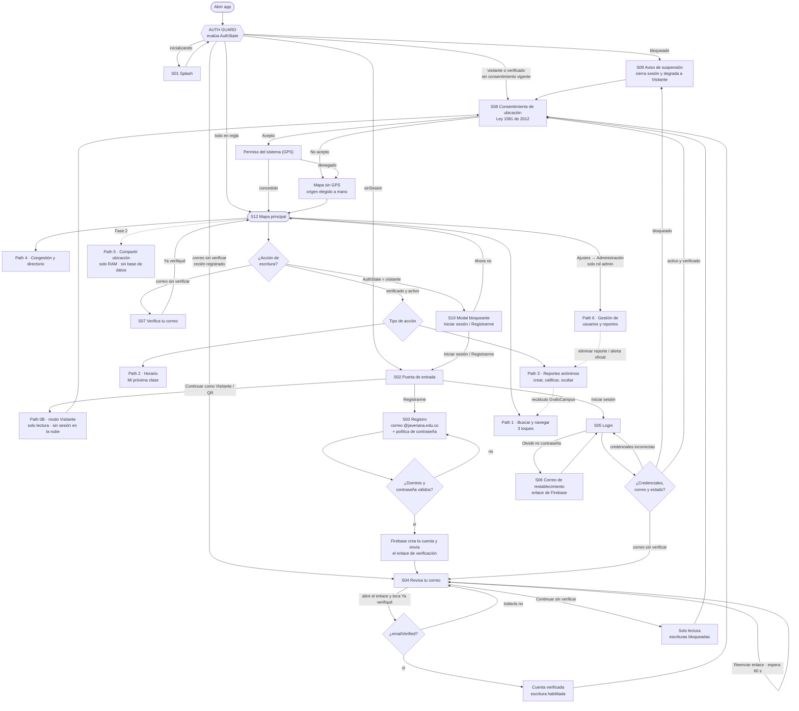
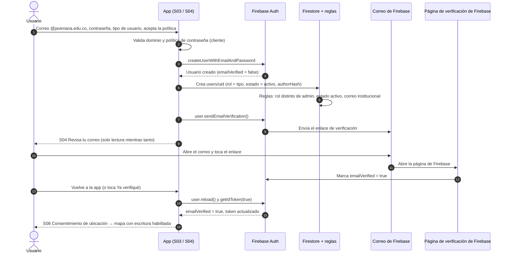
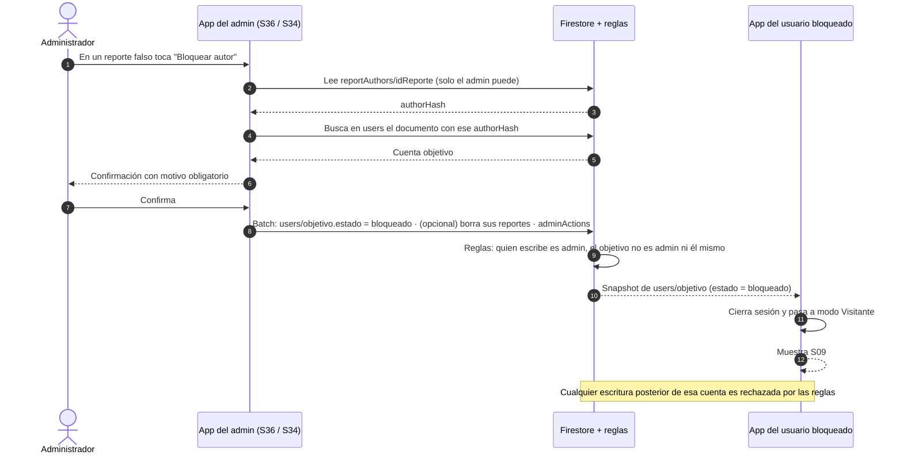

# PontiMaps — Flujos de Usuario (`USER_PATHS.md`)

> **Base:** `REQUIREMENTS.md` (v0.3), `ARCHITECTURE.md` · **Uso:** plano de diseño para Figma y de implementación posterior (no contiene código).
> **Alcance:** puerta de sesión (*Auth Guard*), 3 perfiles de usuario, Paths 0A, 0B y 1 al 6, matriz de permisos, diagramas y checklist de pantallas.
> **Decisiones cerradas que rigen este documento:** backend en plan **Spark** (Firebase Auth + Firestore con reglas, **sin Cloud Functions**); verificación de correo con el **enlace nativo de Firebase** (`user.sendEmailVerification()`); **visitante sin sesión en la nube**; reportes **visualmente anónimos** con `authorHash` privado para moderar; **3 votos negativos** ocultan un reporte; administradores asignados **solo desde la consola**; ubicación compartida en **Fase 2 y solo en RAM**; flujo de **3 toques** con un solo "Ir".

---

## 0. Convenciones

| Símbolo | Significado |
| :--- | :--- |
| **V** | Visitante / Invitado (sin cuenta y sin sesión en la nube) |
| **NV** | Usuario Institucional **no verificado** (registrado, `emailVerified == false`): solo lectura |
| **I** | Usuario Institucional **verificado** (`@javeriana.edu.co`, `emailVerified == true`, `estado == activo`) |
| **A** | Administrador / Moderador (un **I** con `rol: admin`) |
| **B** | Usuario **bloqueado** (`estado == bloqueado`): pierde la escritura y queda degradado a **V** |
| `S##` | Pantalla única del checklist de Figma (§7) |
| `ID de paso` | `P0A-03`, `P1-02`… para trazar pruebas y pantallas |
| **TAD** | Tipo del dominio de `ARCHITECTURE.md` (`Edificio`, `Salon`, `GrafoCampus`, `RutaCalculada`, `ReporteComunidad`, `NegocioServicio`, `BloqueHorario`, `UsuarioPerfil`) |
| ⚙️ | Regla que se aplica **en el servidor** (reglas de Firestore). La UI solo la refleja: *ocultar un botón no es seguridad*. Sin Cloud Functions, las reglas son la única autoridad. |

---

## 1. Regla transversal de sesión (*Auth Guard*)

### 1.1 `AuthState`

Todo flujo empieza evaluando `AuthState` (`UsuarioPerfil.authState` / `authStateDe`). El estado sale de: la sesión de Firebase Auth (`emailVerified`), el documento `users/{uid}` (`estado`, `rol`), la elección local de modo visitante y el consentimiento de ubicación guardado.

| `AuthState` | Cuándo ocurre | Qué puede hacer |
| :--- | :--- | :--- |
| `sinSesion` | No hay sesión **ni** modo visitante elegido | Solo ve la puerta de entrada `S02` |
| `visitante` | Eligió "Continuar como Visitante". **No existe usuario ni registro en Firebase** | Solo lectura |
| `institucionalNoVerificado` | Cuenta registrada con `emailVerified == false` | Solo lectura; verificar el correo |
| `institucionalVerificado` | Cuenta con `emailVerified == true` y `estado == activo` | Acceso completo. Con `rol: admin`, además Administración |
| `bloqueado` | `estado == bloqueado` | Estado de paso: la app cierra la sesión y la **degrada a `visitante`** |

> Estado técnico adicional `inicializando` (Splash `S01`) mientras se lee la sesión y las preferencias; no es un estado de negocio.

### 1.2 Cadena de redirección (se reevalúa en cada cambio de `AuthState` y en cada navegación)

Orden fijo; la primera regla que se cumple gana:

| # | Condición | Redirige a |
| :--- | :--- | :--- |
| 1 | Inicializando | `S01` Splash |
| 2 | `bloqueado` | `S09` Aviso de suspensión; cierra sesión y pasa a `visitante` |
| 3 | `sinSesion` | `S02` Puerta de entrada |
| 4 | Cuenta recién registrada o que inicia sesión con correo sin verificar | `S04` "Revisa tu correo" (se puede **continuar sin verificar**, en solo lectura) |
| 5 | Falta el consentimiento de ubicación **de la versión vigente** del texto | `S08` Consentimiento (Ley 1581) |
| 6 | Ninguna de las anteriores | `S12` Mapa principal |

Reglas adicionales:

- **Consentimiento antes del permiso del sistema:** `Geolocator.requestPermission()` solo se invoca desde `S08`, después de aceptar. Nunca antes.
- **Persistencia:** la elección de modo visitante y el consentimiento de un visitante se guardan **solo en el dispositivo**. El consentimiento de un usuario con cuenta se guarda también en `users/{uid}.consent` (versión + fecha) como evidencia de autorización.
- **Visitante que inicia sesión:** si la cuenta aún no tiene consentimiento registrado, se vuelve a pedir `S08`.
- **Versión del texto de consentimiento:** si cambia, se muestra `S08` de nuevo.
- **Retorno a la acción pendiente (`returnTo`):** si el Guard interrumpió una acción (p. ej. "crear reporte de fila"), tras iniciar sesión y verificar el correo la app vuelve a la pantalla de origen.

### 1.3 Bloqueo de acciones de escritura

Acciones protegidas (requieren **I** o **A**, es decir, `UsuarioPerfil.puedeEscribir`):

| Id | Acción protegida | Dónde se dispara |
| :--- | :--- | :--- |
| W1 | Crear reporte | FAB de reportar `S12`; "Reportar fila" en ficha de negocio `S22` |
| W2 | Calificar un reporte: **"Sigue ahí"** / **"Falso / Ya no está"** | Detalle de reporte `S19` |
| W3 | Guardar, editar o importar horario | `S23`, `S24` |
| W4 | "Mi próxima clase" (usa el horario guardado) | Chip en `S12`, `S25` |
| W5 | Enviar o aceptar una solicitud de ubicación compartida (**Fase 2**) | `S27`–`S29` |
| W6 | Acciones de administración | `S31`–`S38` (además exigen `rol: admin`) |

Comportamiento cuando el estado **no** permite la acción:

| `AuthState` | Respuesta |
| :--- | :--- |
| `visitante` | Se **bloquea** la acción y se abre el modal `S10`: "Necesitas una cuenta institucional verificada", explicación y el botón principal **"Iniciar sesión / Registrarme"** (a `S02`, con `returnTo`). Secundario: "Ahora no". |
| `institucionalNoVerificado` | Se bloquea y se abre `S07`: "Verifica tu correo para continuar", con **Reenviar enlace** y **Ya verifiqué**. |
| `sinSesion` | `S02` |
| `bloqueado` | Ya degradado a `visitante`: `S10` |
| `institucionalVerificado` | La acción continúa |

Los controles bloqueados **se muestran con candado** (no se ocultan) para que el visitante descubra qué obtendría con una cuenta. ⚙️ El servidor rechaza igualmente cualquier escritura que no venga de una cuenta verificada y activa.

### 1.4 Usuario bloqueado

1. El cliente escucha su propio `users/{uid}`. Si `estado` pasa a `bloqueado` → **cierra sesión al instante**, borra los datos locales de la sesión y pasa a modo `visitante` mostrando `S09` (un aviso, no un callejón sin salida).
2. ⚙️ Sin Cloud Functions no se puede deshabilitar la cuenta en Auth ni revocar tokens; el corte lo garantizan **las reglas**: toda escritura exige `perfil().estado == 'activo'`, así que desde el instante del bloqueo ninguna escritura prospera, aunque la app del usuario siguiera abierta.
3. `S09` informa la suspensión con un mensaje genérico (nunca las notas internas del administrador) y un contacto de soporte. El usuario sigue usando la app como **Visitante** (solo lectura).
4. Si el bloqueado vuelve a iniciar sesión, la app lee `estado`, cierra la sesión y repite `S09`. Si lo desbloquean, su siguiente inicio de sesión es normal.

### 1.5 Casos especiales del Guard

| Situación | Comportamiento |
| :--- | :--- |
| Sin internet al arrancar con sesión guardada | Se usa la sesión en caché: lectura con catálogo local y último estado conocido; las escrituras muestran "Sin conexión" (no se encolan). El `estado` se revalida al volver la red; si resulta `bloqueado`, se aplica §1.4. |
| Sin internet y sin sesión | `S02` permite **Continuar como Visitante** (el catálogo semilla funciona offline). Registro e inicio de sesión requieren red. |
| Firebase no configurado / `USE_OFFLINE_FALLBACK=true` (demos, Regla 5) | `AuthRepository` usa cuentas de prueba en memoria; el enlace de verificación se simula con un botón de depuración que **no existe** en builds con Firebase configurado. |
| Cambio de rol en caliente | Al abrir Administración se vuelve a leer `users/{uid}`; si perdió `rol: admin`, sale de las vistas de gestión. |
| Cuenta con otro dominio (p. ej. `@gmail.com`) creada saltándose la UI | Puede existir en Auth (Spark no permite impedirlo), pero ⚙️ las reglas le niegan todo lo privado. |

---

## 2. Perfiles y matriz de permisos

### 2.1 Perfiles

1. **Usuario Institucional (I):** estudiantes, profesores y personal administrativo con cuenta `@javeriana.edu.co` verificada. Acceso completo (navegación, crear y calificar reportes, horario académico). Compartir ubicación *opt-in* llegará en Fase 2. El tipo de usuario es informativo en el MVP.
2. **Visitante (V):** acceso por "Continuar como Visitante" o por un **código QR** del campus (enlace profundo). **Solo lectura:** mapa, buscador, rutas en tiempo real, reportes activos, directorio y congestión. **Cero permisos** de escritura; **no se crea ninguna cuenta ni registro en Firebase Auth** y no se guarda nada en la nube.
3. **Administrador / Moderador (A):** la misma app con vistas de gestión en contexto (Ajustes → Administración). Un **I** con `rol: admin` en su documento de Firestore, asignado **únicamente desde la consola de Firebase** por el equipo. No existe forma de volverse administrador desde la app.

### 2.2 Matriz de permisos

✅ permitido · ❌ no permitido · 🔒 visible con candado (abre `S10` o `S07`) · — no aplica.

| Capacidad | Visitante | Institucional no verificado | Institucional verificado | Bloqueado ¹ | Administrador |
| :--- | :---: | :---: | :---: | :---: | :---: |
| Ver mapa, buscar edificios / salones / negocios | ✅ | ✅ | ✅ | ✅ | ✅ |
| Calcular y seguir una ruta (GPS en vivo) | ✅ | ✅ | ✅ | ✅ | ✅ |
| Ver reportes activos (siempre anónimos) | ✅ | ✅ | ✅ | ✅ | ✅ |
| Ver congestión y directorio (horarios, abierto/cerrado, fila) | ✅ | ✅ | ✅ | ✅ | ✅ |
| Crear reporte (cierre / fila / alta afluencia) | 🔒 | 🔒 | ✅ | ❌ | ✅ |
| Calificar reporte ("Sigue ahí" / "Falso / Ya no está") | 🔒 | 🔒 | ✅ | ❌ | ✅ |
| Guardar / editar horario | 🔒 | 🔒 | ✅ | ❌ | ✅ |
| "Mi próxima clase" y alertas de salida | 🔒 | 🔒 | ✅ | ❌ | ✅ |
| Compartir ubicación con compañeros (**Fase 2**) | 🔒 | 🔒 | ✅ (opt-in) | ❌ | ✅ (opt-in) |
| Revocar o pausar el GPS; ver y cambiar consentimientos | ✅ (local) | ✅ | ✅ | ✅ (local) | ✅ |
| Cerrar sesión | — | ✅ | ✅ | — | ✅ |
| Eliminar mi cuenta y mis datos | — | ✅ | ✅ | ❌ (contactar soporte) | ✅ ² |
| Ver el **autor** de un reporte (`authorHash` → cuenta) | ❌ | ❌ | ❌ | ❌ | ✅ |
| Listar / buscar todos los usuarios y ver su estado | ❌ | ❌ | ❌ | ❌ | ✅ |
| Bloquear / desbloquear usuarios; **"Bloquear autor"** desde un reporte | ❌ | ❌ | ❌ | ❌ | ✅ ³ |
| Listar todos los reportes activos | ❌ | ❌ | ❌ | ❌ | ✅ |
| Eliminar cualquier reporte al instante | ❌ | ❌ | ❌ | ❌ | ✅ |
| Publicar / levantar alertas oficiales fijas | ❌ | ❌ | ❌ | ❌ | ✅ |
| **Ver la ubicación de otros usuarios** | ❌ | ❌ | solo en vivo de quien aceptó (Fase 2) | ❌ | ❌ ⁴ |
| Escritura directa a Firestore de `rol`, `estado` o `authorHash` propios | ❌ | ❌ | ❌ | ❌ | ❌ |

¹ El bloqueado queda degradado automáticamente a Visitante (§1.4): conserva la lectura y pierde toda escritura.
² No puede eliminar la cuenta si es el último administrador.
³ No puede bloquearse a sí mismo ni a otro administrador (⚙️ las reglas lo impiden).
⁴ El administrador no tiene acceso a posiciones de nadie: en Fase 2 la ubicación no se guarda en ninguna base de datos, solo vive en la RAM del compañero autorizado.

---

## 3. Diagramas

### 3.1 Flujo global (`flowchart TD`)

### 3.2 Registro con enlace de verificación nativo (`sequenceDiagram`)

### 3.3 Bloqueo de un autor por un administrador, sin Cloud Functions (`sequenceDiagram`)

---

## 4. Paths

Formato de cada paso: **Pantalla / estado → Acción del usuario → Validación Auth/Rol → Respuesta del sistema y TADs**. Después de cada tabla: *Happy path* y *Edge cases*.

### Path 0A — Gatekeeper de sesión, registro y verificación por enlace

**Roles:** V → NV → I · **Pantallas:** `S01`–`S08`

#### 0A.1 Revisión inicial y puerta de entrada

| ID | Pantalla / estado | Acción | Validación Auth/Rol | Respuesta del sistema y TADs |
| :--- | :--- | :--- | :--- | :--- |
| P0A-01 | `S01` Splash con logo PontiMaps | Abre la app | Lee sesión de Firebase, `users/{uid}` (estado, rol), modo visitante y consentimiento locales | `authStateDe(perfil)` y cadena de redirección (§1.2) |
| P0A-02 | `S02` Puerta de entrada (sin sesión ni modo elegido) | Elige **Iniciar sesión**, **Registrarme** o **Continuar como Visitante** | — | Cada opción abre su flujo: `S05`, `S03`, Path 0B |

#### 0A.2 Registro nuevo (correo institucional + contraseña)

| ID | Pantalla / estado | Acción | Validación Auth/Rol | Respuesta del sistema y TADs |
| :--- | :--- | :--- | :--- | :--- |
| P0A-03 | `S03` Registro | Escribe el correo | En vivo: formato y dominio exactamente `@javeriana.edu.co` (sin distinguir mayúsculas; `ana@javeriana.edu.co.evil.com` y espacios internos se rechazan). Error inline junto al campo | `UsuarioPerfil.esCorreoInstitucional()` |
| P0A-04 | `S03` | Escribe la contraseña y su confirmación | **Política** (tabla de abajo) evaluada en vivo | Lista de requisitos con ✓/✗ **y texto** y **indicador de fortaleza** (Débil / Media / Fuerte) |
| P0A-05 | `S03` | Elige el tipo de usuario (Estudiante / Profesor / Administrativo) y marca la autorización de tratamiento del correo | La autorización es obligatoria (Ley 1581). **El tipo "Administrador" no existe en la lista** | `UsuarioPerfil.registro(...)` rechaza `admin` e `invitado` |
| P0A-06 | `S03` | Toca **Crear cuenta** | El botón solo se habilita con correo, contraseña, confirmación y autorización válidos | Firebase Auth crea la cuenta (sin verificar); se crea `users/{uid}` con `estado = activo`, el tipo elegido y su `authorHash`. ⚙️ Las reglas rechazan cualquier `rol: admin` o `estado` distinto de `activo` |
| P0A-07 | `S03` → `S04` | — | — | La app llama a **`user.sendEmailVerification()`** y abre `S04`. `AuthState = institucionalNoVerificado` |
| P0A-08 | `S04` "Revisa tu correo" | Lee el aviso "Te enviamos un enlace a a\*\*\*@javeriana.edu.co" | — | Botones: **Reenviar enlace** (espera de 60 s), **Ya verifiqué**, **Cambiar correo**, **Continuar sin verificar (solo lectura)** |
| P0A-09 | Correo / navegador | Abre el correo y toca el enlace | — | Firebase marca `emailVerified = true` en su página de verificación; el usuario vuelve a la app |
| P0A-10 | `S04` | Toca **Ya verifiqué** (o simplemente vuelve a la app) | — | La app hace `reload()` + `getIdToken(true)` para que las reglas vean el correo verificado. Si ya está verificado → `institucionalVerificado`; si no, mensaje "Aún no está verificado" |
| P0A-11 | `S08` Consentimiento de ubicación | (ver Path 0B para el detalle) | Se muestra si falta el consentimiento de la versión vigente | Guarda versión y fecha en `users/{uid}.consent` |
| P0A-12 | `S12` Mapa principal | — | `AuthState = institucionalVerificado` | Mapa completo con todas las acciones habilitadas |

**Política de contraseña** (se valida en el cliente; en Spark no hay forma de imponerla en el servidor):

| Regla | Detalle |
| :--- | :--- |
| Longitud | Mínimo **8** caracteres (máximo 128) |
| Mayúscula | Al menos **1** letra mayúscula |
| Minúscula | Al menos **1** letra minúscula |
| Número | Al menos **1** dígito |
| Símbolo especial | Al menos **1** carácter no alfanumérico (por ejemplo `@ # $ % & * !`) |
| Espacios | Sin espacios **al inicio ni al final** |
| Nombre de usuario | No puede contener la parte local del correo (antes de `@`), sin distinguir mayúsculas; se aplica cuando esa parte tiene ≥ 3 caracteres |
| Confirmación | Debe coincidir con la contraseña |

**Indicador de fortaleza (nunca solo por color — WCAG 1.4.1):** 3 segmentos + etiqueta de texto.
- *Débil:* falta alguna regla → **Crear cuenta** sigue deshabilitado.
- *Media:* cumple todas las reglas con 8 a 11 caracteres.
- *Fuerte:* cumple todas las reglas con 12 o más caracteres.

**Enlace de verificación — parámetros:**

| Parámetro | Valor |
| :--- | :--- |
| Mecanismo | Enlace nativo de Firebase Auth (`sendEmailVerification()`); funciona en el plan Spark. **Sin OTP y sin Cloud Functions de correo** |
| Reenvío | Botón con espera de 60 s en el cliente; Firebase aplica además sus propios límites |
| Caducidad y uso | El enlace caduca y es de un solo uso (el plazo exacto lo define Firebase); si caduca, se reenvía |
| Efecto | Hasta `emailVerified == true` la cuenta es de solo lectura: ⚙️ las reglas rechazan toda escritura |
| Pantalla de verificación | La página de acción por defecto de Firebase; se personaliza la plantilla del correo en español desde la consola |

#### 0A.3 Inicio de sesión

| ID | Pantalla / estado | Acción | Validación Auth/Rol | Respuesta del sistema y TADs |
| :--- | :--- | :--- | :--- | :--- |
| P0A-13 | `S05` Login | Escribe correo y contraseña (con interruptor mostrar/ocultar) y toca **Iniciar sesión** | Formato de correo y campos no vacíos | Firebase Auth valida credenciales |
| P0A-14 | `S05` | — | Se lee `users/{uid}` (`estado`, `rol`) y `emailVerified` | Activo y verificado → `S08` si falta consentimiento, si no `S12` · Correo sin verificar → `S04` · `bloqueado` → cierra sesión, `S09` y modo Visitante |
| P0A-15 | `S05` | Error de credenciales | Mensaje **genérico** "Correo o contraseña incorrectos" (no revela si el correo existe) | Tras varios fallos, Firebase aplica un bloqueo temporal: "Demasiados intentos, espera unos minutos" |

#### 0A.4 Recuperación de contraseña

| ID | Pantalla / estado | Acción | Validación Auth/Rol | Respuesta del sistema y TADs |
| :--- | :--- | :--- | :--- | :--- |
| P0A-16 | `S06` Recuperar contraseña | Escribe su correo y toca **Enviar enlace** | Formato y dominio | `sendPasswordResetEmail`: responde **siempre** "Si el correo tiene cuenta, enviamos un enlace" (no revela si existe) |
| P0A-17 | Correo / navegador | Abre el enlace y elige una contraseña nueva en la página de Firebase | La página de Firebase aplica la política de contraseñas del proyecto, si está configurada | Firebase actualiza la contraseña |
| P0A-18 | `S05` | Inicia sesión con la contraseña nueva | — | Flujo de P0A-13 |

**Happy path:** `S01` → `S02` → `S03` (correo válido, contraseña Fuerte, autorización) → `S04` (abre el enlace del correo, toca **Ya verifiqué**) → `S08` (acepta) → permiso GPS concedido → `S12` con escritura habilitada.

**Edge cases**

| # | Situación | Comportamiento esperado |
| :--- | :--- | :--- |
| E0A-01 | Correo de otro dominio (`@gmail.com`, `@javeriana.edu`, etc.) | Error inline antes de enviar: "Usa tu correo institucional @javeriana.edu.co". Si alguien se salta la UI, ⚙️ las reglas le niegan todo lo privado |
| E0A-02 | Correo ya registrado (`email-already-in-use`) | En **registro**: "Este correo ya tiene cuenta. Inicia sesión o recupera tu contraseña" (se acepta el pequeño riesgo de enumeración por usabilidad). En **login** y **recuperación** los mensajes son siempre genéricos |
| E0A-03 | Contraseña débil / sin símbolo / con espacios al inicio o fin / contiene el usuario del correo | Requisito en ✗ con explicación; botón deshabilitado |
| E0A-04 | Confirmación de contraseña distinta | Error inline; botón deshabilitado |
| E0A-05 | Toca **Ya verifiqué** sin haber abierto el enlace | "Aún no está verificado. Revisa tu correo (también la carpeta de spam)" |
| E0A-06 | Enlace **caducado** o ya usado | Firebase lo indica en su página; la app ofrece **Reenviar enlace** |
| E0A-07 | **Reenviar** antes de 60 s o demasiados reenvíos | Botón deshabilitado con cuenta regresiva visible (texto, no solo color). Si Firebase responde `too-many-requests`: "Demasiados intentos. Intenta de nuevo más tarde" |
| E0A-08 | El correo no llega | Ayuda: revisar spam, esperar, **Reenviar** o **Cambiar correo**. La entregabilidad hacia `@javeriana.edu.co` debe probarse antes del piloto |
| E0A-09 | Verificó desde otro dispositivo o navegador | Al volver a la app y refrescar, queda verificado: la verificación es de la cuenta, no del dispositivo |
| E0A-10 | Escribió mal su correo | **Cambiar correo** elimina la cuenta no verificada (recién creada, no requiere reautenticación) y vuelve a `S03` |
| E0A-11 | Alguien registra el correo de otra persona con una contraseña propia | Esa cuenta nunca queda verificada: es de solo lectura y no puede hacer nada. El dueño real usa **Recuperar contraseña** (el enlace llega a *su* correo), fija su propia contraseña y verifica |
| E0A-12 | Cuentas sin verificar que se acumulan | Sin Cloud Functions no hay limpieza automática; son inofensivas (solo lectura). Se pueden depurar a mano desde la consola |
| E0A-13 | Cierra la app a mitad de la verificación | Al volver, login → correo sin verificar → `S04` |
| E0A-14 | **Sin internet** en registro / login / recuperación | "Necesitas conexión para registrarte". Se ofrece **Continuar como Visitante** (el catálogo funciona sin red) |
| E0A-15 | Usuario **bloqueado** inicia sesión | Termina en `S09` y modo Visitante; ninguna función de escritura |
| E0A-16 | Intenta una acción de escritura sin verificar | `S07` "Verifica tu correo para continuar" con **Reenviar enlace** / **Ya verifiqué** |
| E0A-17 | Sesión expirada o revocada | Vuelve a `S02` conservando `returnTo` |
| E0A-18 | El restablecimiento de contraseña no aplica la política (página web de Firebase) | Riesgo aceptado: solo afecta a la propia cuenta; se activa la política en la consola si está disponible |
| E0A-19 | Modo demo offline (sin Firebase) | Cuentas de prueba en memoria y botón de depuración para "verificar"; nunca en builds con Firebase |

---

### Path 0B — Acceso como Visitante

**Roles:** V · **Pantallas:** `S02`, `S08`, `S12`, `S10`

| ID | Pantalla / estado | Acción | Validación Auth/Rol | Respuesta del sistema y TADs |
| :--- | :--- | :--- | :--- | :--- |
| P0B-01 | `S02` Puerta de entrada (o enlace de un **QR del campus**) | Toca **Continuar como Visitante** | — (el QR contiene solo un enlace fijo; no entrega permisos) | `AuthState = visitante` (`UsuarioPerfil.invitado()`, sin `uid`). La elección se guarda **solo en el dispositivo**. **No se crea usuario en Firebase Auth ni ningún registro** |
| P0B-02 | `S08` Consentimiento de ubicación (variante visitante) | Lee la finalidad y toca **Acepto** o **No acepto** | Obligatorio antes de cualquier solicitud de GPS | Explica que la posición se usa solo en el dispositivo para guiar la ruta, no se guarda ni se envía. Registra la aceptación solo en local |
| P0B-03 | Permiso del sistema | Concede o niega | — | Concedido → GPS en vivo. Denegado → mapa sin GPS (origen manual) |
| P0B-04 | `S12` Mapa principal en **solo lectura** | Navega | Insignia permanente "Modo visitante" | Habilitados: mapa, buscador, rutas con GPS, reportes activos, congestión, directorio. FAB de reportar, calificar y "Mi próxima clase" aparecen **con candado** |
| P0B-05 | `S10` Modal bloqueante | Toca un control con candado | `AuthState = visitante` y acción de escritura | Se bloquea la acción y se muestra el modal con **"Iniciar sesión / Registrarme"** y "Ahora no". El botón lleva a `S02` con `returnTo` |
| P0B-06 | `S26` Ajustes | Ve "Iniciar sesión / Registrarme"; puede **revocar el GPS** | — | Revocar detiene el flujo de posiciones en < 1 s; la app sigue en modo sin GPS |

**Happy path:** `S02` → Visitante → `S08` (acepta) → permiso GPS concedido → `S12` con insignia "Modo visitante" → usa Path 1 y Path 4.

**Edge cases**

| # | Situación | Comportamiento esperado |
| :--- | :--- | :--- |
| E0B-01 | Visitante toca FAB de reportar, calificar o "Mi próxima clase" | `S10`; nunca se envía nada al servidor. ⚙️ Aunque se manipulara la app, las reglas rechazan la escritura |
| E0B-02 | Entra por **QR** con la app instalada / sin instalar | Con la app: abre directo `S08` en modo visitante. Sin ella: ruta a la tienda; al abrirla por primera vez se pasa por `S02` |
| E0B-03 | El QR trae un parámetro (p. ej. puerta de origen) | Se valida contra el catálogo; si no existe, se ignora. Nunca se confía en el contenido del QR |
| E0B-04 | GPS denegado | Búsqueda y rutas funcionan eligiendo el origen en el mapa o en una lista de entradas del campus |
| E0B-05 | Sin internet | Catálogo semilla y cálculo de rutas funcionan offline; reportes y congestión muestran "Sin conexión; datos del último momento conocido" |
| E0B-06 | **900+ visitantes a la vez** (inducción o evento) | El catálogo y el cálculo de rutas son locales; solo se lee el conjunto de reportes activos con un *listener* acotado. Sin sesiones en Auth. Si se agota la cuota gratuita: "Reportes no disponibles por alta demanda" y la app sigue con catálogo y rutas |
| E0B-07 | Visitante decide registrarse | `S10` / Ajustes → `S02`; tras verificar el correo continúa y vuelve a lo que hacía |
| E0B-08 | Usuario bloqueado | Se comporta exactamente como visitante |
| E0B-09 | Se desinstala o se borran los datos | Se pierde la elección de modo visitante y el consentimiento local: se vuelve a pedir |

---

### Path 1 — Búsqueda y navegación a un edificio o salón

**Roles:** V, NV, I, A, B (todos, solo lectura) · **Metas:** `≤ 3` toques con **un solo "Ir"** · `< 30 s` desde el ingreso efectivo al mapa hasta iniciar la ruta · ruta `< 2 s` · posición `≤ 5 m` cada `1 s` · tiempo estimado `± 1 min` · **Pantallas:** `S12`–`S17`

| ID | Pantalla / estado | Acción | Validación Auth/Rol | Respuesta del sistema y TADs |
| :--- | :--- | :--- | :--- | :--- |
| P1-01 | `S12` Mapa (Guard ya resuelto) | **Ingreso efectivo al mapa** (post-login o modo visitante): empieza a contar el tiempo | Cualquier `AuthState` con consentimiento vigente | Campus, barra de búsqueda **fija arriba** y posición del usuario si hay GPS |
| P1-02 | `S12` → `S13` | **Toque 1:** toca la barra fija y escribe (p. ej. "51", "gerardo arango" o "301") | — | Búsqueda local e instantánea: `Edificio.coincideConBusqueda(query)` y `Edificio.buscarSalon(codigo)`; resultados agrupados *Edificios · Salones · Servicios* |
| P1-03 | `S13` → `S14` | **Toque 2:** elige el edificio o salón | — | Tarjeta `S14`: para un salón, `Salon.etiquetaUbicacion()` → **"Edificio 51 · Piso 3"** (nunca un salón sin edificio y piso). **El edificio ya es visible: la meta de ≤ 3 toques se cumple en 2** |
| P1-04 | `S14` | **Toque 3: "Ir"** (único botón). Opcional: interruptor "Evitar escaleras" | — | `GrafoCampus.aplicarReportesVigentes(reportes, ahora)` y `calcularRutaAStar(origen, salon.idEdificio, evitarEscaleras)` → `RutaCalculada` (< 2 s) |
| P1-05 | `S15` Ruta en curso (su primer estado es la **vista previa**) | Revisa el resumen mientras empieza a caminar | — | Polilínea encuadrada y tarjeta inferior con **distancia (m)**, **tiempo estimado (± 1 min)**, **siguiente tramo** y, si `tieneDesvioPorReporte`, "Ruta ajustada por un cierre o fila reportados". **No hay una segunda confirmación**: la navegación en vivo comienza de inmediato. Termina el conteo de los 30 s |
| P1-06 | `S16` Navegación activa | Camina | Igual que P1-01 | Posición en vivo (1 s, ≤ 5 m). `RutaCalculada.obtenerSiguienteTramo(posicion)` actualiza la instrucción; cada cambio de reportes vigentes recalcula el grafo |
| P1-07 | `S16` | Se desvía > 25 m o llega un reporte que toca la ruta | — | Recalcula en < 2 s y avisa sin interrumpir ("Ruta actualizada"). Si el cierre aísla el destino → mensaje con el motivo (`bloqueadoPorReportes`) |
| P1-08 | `S17` Llegada | — | — | `RutaCalculada.haLlegado(posicion, radio = 15 m)` → "Edificio X · Piso Y · Salón Z" como recordatorio; la posición no se guarda |

**Presupuesto de tiempo (referencia < 30 s, medido desde P1-01):** tocar la barra y escribir ≈ 6–8 s · elegir resultado ≈ 2 s · "Ir" ≈ 1–2 s · ruta < 2 s ⇒ ≈ 12–15 s. **No incluye el registro ni la verificación del correo**; un visitante llega a P1-01 tras 2 toques de la puerta más el consentimiento.

**Happy path:** `S12` → barra (toque 1) → "51" → resultado (toque 2) → "Edificio 51 · Piso 3" → **Ir** (toque 3) → ruta con distancia y tiempo → camina → llegada.

**Edge cases**

| # | Situación | Comportamiento esperado |
| :--- | :--- | :--- |
| E1-01 | Sin resultados | "No encontramos ese edificio o salón" + sugerencias |
| E1-02 | Código de salón inexistente | Mismo mensaje; nunca se inventa un edificio ni un piso |
| E1-03 | Búsqueda con tildes, mayúsculas, "ed 51", "edificio 51" | Resuelta por la normalización de `Edificio.coincideConBusqueda` |
| E1-04 | **GPS denegado** o revocado | Aviso no bloqueante; se pide elegir el origen. Sin navegación en vivo, la ruta estática sí funciona |
| E1-05 | GPS débil a mitad de ruta | Indicador "Señal GPS débil" (> 5 m de precisión); la ruta se mantiene |
| E1-06 | Usuario fuera del campus (lejos de cualquier nodo) | No se ajusta en silencio al nodo más cercano: "Parece que estás fuera del campus. Elige tu punto de partida" |
| E1-07 | El edificio no tiene entradas en el grafo | `edificioSinEntradas`: "Aún no tenemos la entrada de este edificio" |
| E1-08 | Sin ruta (`desconectado`) | Mensaje claro y opción de elegir otro origen |
| E1-09 | Todos los caminos cerrados por reportes (`bloqueadoPorReportes`) | "Los cierres reportados bloquean el camino. Intenta más tarde" + ver reportes en el mapa |
| E1-10 | Destino sin acceso para movilidad reducida y "Evitar escaleras" activo | Aviso explícito en `S14` con `RutaCalculada.accesoVertical`: "Sin ascensor (solo escaleras internas para piso N)" o, si el dato no está levantado, "Acceso por ascensor sin confirmar para el piso N"; con ascensor se muestra "Acceso por ascensor disponible" y, si hay varios, "(múltiples ascensores)". Se muestra la mejor alternativa de ruta exterior |
| E1-11 | **Sin internet** | Catálogo y cálculo de rutas funcionan offline; reportes con el último estado conocido y aviso |
| E1-12 | App en segundo plano / pantalla apagada | Se detiene la lectura continua de GPS (batería ≤ 5 % por 15 min); se retoma al volver |
| E1-13 | Texto al 200 % / rotación | La tarjeta inferior sigue mostrando los 4 datos sin desbordes |
| E1-14 | Revoca el GPS desde Ajustes mientras navega | El flujo se cancela en < 1 s y pasa a ruta estática |
| E1-15 | Llegada con poca precisión | Se confirma con `haLlegado` (≤ 15 m); si la precisión es peor, se ofrece "Ya llegué" manual |

---

### Path 2 — Horario académico y "Mi próxima clase"

**Roles:** I, A (V, NV y B bloqueados) · **Pantallas:** `S07`, `S10`, `S23`, `S24`, `S25`

| ID | Pantalla / estado | Acción | Validación Auth/Rol | Respuesta del sistema y TADs |
| :--- | :--- | :--- | :--- | :--- |
| P2-01 | `S12` → chip **"Mi próxima clase"** | Toca el chip (acceso de 1 toque) | `puedeEscribir`: **V** → `S10` · **NV** → `S07` · **I/A** → continúa | Para V y NV el chip se ve con candado |
| P2-02 | `S25` Mi próxima clase | Revisa | — | `UsuarioPerfil.obtenerProximaClase(horario, ahora)` → `BloqueHorario`; muestra materia, hora, **Edificio · Piso · Salón** y la `RutaCalculada` |
| P2-03 | `S25` | Toca **Ir** | — | Mismo flujo que Path 1 desde P1-04, con el edificio y salón de la clase |
| P2-04 | `S25` | Ve la **hora de salida sugerida** | — | `salida = inicio − (ETA × factorCongestión) − 2 min`; la congestión sale de los reportes vigentes del `GrafoCampus`. Notificación local "Sal en N min hacia Ed. X, Piso Y" |
| P2-05 | `S23` Horario | Toca **Agregar clase** | **V** → `S10` · **NV** → `S07` · **I/A** → continúa | Abre `S24` |
| P2-06 | `S24` Editar clase | Completa materia, día(s), inicio y fin, edificio y salón | Edificio y salón se **eligen del catálogo**; `horaFin > horaInicio` | Crea/actualiza `BloqueHorario`. Se **guarda en el dispositivo**, asociado a la cuenta (nunca en la nube) |
| P2-07 | `S24` | Guarda | **V/NV/B**: bloqueado · **I/A**: permitido | Vuelve a `S23`; reprograma las alertas de salida |
| P2-08 | `S23` | Edita o elimina una clase | Igual que P2-07 | Confirmación al eliminar; actualiza alertas |

**Happy path:** I abre `S12` → toca "Mi próxima clase" → ve "Cálculo Diferencial · 10:00 · Edificio 51 · Piso 3 · Salón 301 · 6 min a pie" → **Ir** → Path 1.

**Edge cases**

| # | Situación | Comportamiento esperado |
| :--- | :--- | :--- |
| E2-01 | Visitante toca "Mi próxima clase", **Agregar** o **Guardar** | `S10`; no se guarda nada (ni local ni en la nube) |
| E2-02 | Usuario sin verificar | `S07` en lugar de `S10` |
| E2-03 | No hay horario | Estado vacío con acción "Agregar mi primera clase" |
| E2-04 | No quedan clases hoy | Se muestra la próxima de otro día (hasta 7 días) indicando el día |
| E2-05 | La clase empezó hace menos de 10 min | Sigue siendo la "próxima" (tolerancia de `obtenerProximaClase`): "Tu clase empezó hace N min" con **Ir** |
| E2-06 | Clase que empezó hace más de 10 min | Pasa a la siguiente |
| E2-07 | Hora fin ≤ inicio, día vacío, salón fuera del catálogo | Error inline y **Guardar** deshabilitado |
| E2-08 | Dos clases se solapan | Advertencia (se puede guardar) |
| E2-09 | Notificaciones del sistema denegadas | Las alertas quedan solo dentro de la app; el permiso se pide la primera vez que se guarda un horario, con explicación previa |
| E2-10 | Mucha congestión | La hora de salida se adelanta ("por alta afluencia en tu camino") |
| E2-11 | La ruta a la clase está bloqueada | Aviso con el motivo y sugerencia de salir antes |
| E2-12 | Sin GPS | Se muestra la clase y la hora; la ruta pide elegir origen |
| E2-13 | Cierre de sesión | El horario local queda en el dispositivo asociado a esa cuenta; no se muestra a otra |
| E2-14 | Usuario bloqueado | Ya es visitante: no accede al horario guardado |

---

### Path 3 — Reportes colaborativos en tiempo real (ciclo Waze)

**Roles:** crear y calificar: I, A · ver: V, NV, I, A, B · **Pantallas:** `S18`, `S19`, `S07`, `S10`

**Anonimato:** ninguna pantalla muestra nombre, correo, `uid` ni `authorHash` del autor de un reporte, ni en el mapa ni en listas públicas.

#### 3.1 Crear un reporte

| ID | Pantalla / estado | Acción | Validación Auth/Rol | Respuesta del sistema y TADs |
| :--- | :--- | :--- | :--- | :--- |
| P3-01 | `S12` | **Toque 1:** FAB **Reportar** | `puedeEscribir`: **V** → `S10` · **NV** → `S07` · **I/A** → continúa | Abre `S18` |
| P3-02 | `S18` Modal de reporte | **Toque 2:** elige **Cierre de paso**, **Fila larga** o **Alta afluencia** | Cada opción tiene **icono + etiqueta de texto** y zona táctil ≥ 48 × 48 dp. No hay campo de texto libre | La posición actual se **ajusta en el dispositivo** a la arista más cercana (`GrafoCampus.aristaMasCercana`); no se envían coordenadas del usuario |
| P3-03 | `S18` → `S12` | — | ⚙️ Las reglas validan: cuenta verificada y activa, tipo permitido, `expiraEn = creadoEn + 60 min`, contadores en cero, **intervalo mínimo entre reportes** | `ReporteComunidad.nuevo(..., authorHash: perfil.authorHash)`. *Batch*: documento público `reports/{id}` (`toMap()`, **sin autor**) + `reportAuthors/{id}` (`toMapAutoria()`, solo administrador y autor) |
| P3-04 | `S12` | Ve el nuevo marcador | — | Aparece en < 30 s para todos (incluidos visitantes); cada cliente ejecuta `GrafoCampus.aplicarReportesVigentes` y, si la ruta activa se ve afectada, la recalcula |

#### 3.2 Calificar, ocultar y expirar

| ID | Pantalla / estado | Acción | Validación Auth/Rol | Respuesta del sistema y TADs |
| :--- | :--- | :--- | :--- | :--- |
| P3-05 | `S12` → `S19` Detalle de reporte | Toca un marcador (**todos pueden verlo**) | — | Tipo, hace cuánto se creó, tiempo restante y los botones **"Sigue ahí"** / **"Falso / Ya no está"**. Sin ninguna identidad |
| P3-06 | `S19` | Toca uno de los dos botones | **V** → candado y `S10` · **NV** → `S07` · **I/A** → continúa · ⚙️ un voto por cuenta y reporte; el autor no vota el suyo | **Sigue ahí:** `ReporteComunidad.confirmar(ahora)` (+1, `expiraEn + 30 min`, tope 180 min desde la creación). **Falso / Ya no está:** `negar()` (+1 negativo) |
| P3-07 | — | **3 o más votos negativos** | — | `estaVigente` pasa a `false` y el reporte **se oculta automáticamente** del mapa, aunque tenga confirmaciones; deja de afectar al grafo |
| P3-08 | — | Pasan **60 min** sin confirmación | — | `estaVigente(ahora)` es falso: sale del mapa y del grafo. El cliente filtra por `expiraEn`; el borrado del documento llega después |
| P3-09 | `S12` | — | — | Cuando un reporte expira, se oculta o lo borra un administrador, los clientes recalculan; la ruta vuelve a su trazado normal |

**Happy path:** I toca el FAB (toque 1) → **Fila larga** (toque 2) → el marcador aparece en < 30 s → otros lo confirman con "Sigue ahí" → vive hasta 3 h como máximo → expira.

**Edge cases**

| # | Situación | Comportamiento esperado |
| :--- | :--- | :--- |
| E3-01 | Visitante toca el FAB o los botones de calificar | `S10`; no se envía nada. ⚙️ Las reglas lo rechazarían igual |
| E3-02 | Usuario sin verificar | `S07` "Verifica tu correo para continuar" |
| E3-03 | Usuario **bloqueado** | Ya es visitante (`S10`). ⚙️ Si una app antigua intentara escribir, las reglas la rechazan por `estado ≠ activo` |
| E3-04 | Reporta dos veces seguidas | "Espera un momento antes de reportar de nuevo" (intervalo mínimo validado en reglas) |
| E3-05 | Ya existe un reporte igual en el mismo tramo | Mejor esfuerzo en el cliente: se ofrece "Ya estaba reportado. ¿Confirmarlo?" |
| E3-06 | **Sin internet** | No se puede publicar ni votar: "Sin conexión, no se envió". No se encola (un reporte tardío engañaría) |
| E3-07 | GPS denegado | Se puede elegir el tramo tocando el mapa; se ajusta a la arista más cercana |
| E3-08 | A más de 30 m de cualquier sendero | Se pide elegir el tramo en el mapa; si no hay ninguno cercano: "Acércate a un sendero para reportar" |
| E3-09 | Reporte falso lejos de donde está el usuario | **Limitación aceptada:** sin servidor no se valida la cercanía y, por privacidad, no se envían coordenadas del usuario. Se mitiga con el intervalo mínimo, los votos negativos de la comunidad y la moderación del administrador |
| E3-10 | 2 votos negativos y 2 confirmaciones | Sigue vigente (el ocultamiento exige 3 negativos) |
| E3-11 | Confirmar un reporte ya vencido u oculto | "Este reporte ya no está activo"; no se revive |
| E3-12 | Un administrador elimina un reporte | Desaparece de todos los clientes sin esperar los 60 min |
| E3-13 | Cierre de paso que aísla un destino mientras se navega | Mensaje de `bloqueadoPorReportes` (ver E1-09) |
| E3-14 | Etiquetas en el mapa | Contraste ≥ 4,5:1 |
| E3-15 | Alguien intenta ver quién publicó un reporte | Imposible: el documento público no contiene al autor y ⚙️ `reportAuthors` solo lo lee el administrador (y el propio autor) |

---

### Path 4 — Congestión y directorio de negocios y servicios

**Roles:** lectura para V, NV, I, A, B · reportar fila desde una ficha solo I/A · **Pantallas:** `S12`, `S20`–`S22`

| ID | Pantalla / estado | Acción | Validación Auth/Rol | Respuesta del sistema y TADs |
| :--- | :--- | :--- | :--- | :--- |
| P4-01 | `S12` | Activa la capa **Congestión** | Lectura permitida para **todos** | `S20`: zonas con nivel **Baja / Media / Alta** (color **más** etiqueta o patrón), calculadas **solo de los reportes activos** (la presencia agregada es de Fase 2) |
| P4-02 | `S20` | Revisa la leyenda | — | Sin historial por usuario (Ley 1581). Si no hay reportes, "Sin datos recientes" |
| P4-03 | `S12` / `S21` Directorio | Filtra por categoría (cafeterías, papelerías, atención al estudiante, bienestar, comercios aliados) o busca | — | Marcadores y lista de `NegocioServicio`; también aparecen en el buscador (Path 1) |
| P4-04 | `S22` Ficha de negocio | Toca un negocio | — | Nombre, categoría, horario, **estado** (`NegocioServicio.estaAbierto(ahora)` → Abierto / Cerrado / Cierra pronto) y **nivel de fila** (`nivelFilaActual`, o **"Sin datos recientes"** si es nulo) |
| P4-05 | `S22` | Toca **Ir** | — | Ruta hacia la entrada del `idEdificioCercano` con el flujo de Path 1 (desde P1-04) |
| P4-06 | `S22` | Toca **Reportar fila** | **V** → `S10` · **NV** → `S07` · **I/A** → abre `S18` con "Fila larga" preseleccionada | Crea el reporte según Path 3 |

**Happy path:** V abre la capa de congestión → ve la Biblioteca en "Alta" → filtra "Cafeterías" → ve "Cafetería Central · Abierto · Fila media" → **Ir** → Path 1.

**Edge cases**

| # | Situación | Comportamiento esperado |
| :--- | :--- | :--- |
| E4-01 | Negocio **cerrado** | "Cerrado · abre a las HH:mm"; se permite ir con un aviso |
| E4-02 | Cierra en menos de 30 min | "Cierra pronto" |
| E4-03 | Horario que cruza la medianoche o 24 h | Resuelto por `estaAbierto` (apertura incluida, cierre excluido) |
| E4-04 | Sin reporte de fila vigente | "Sin datos recientes" (nunca "Sin fila") |
| E4-05 | Sin internet | Directorio y horarios desde el catálogo local; congestión y filas con "Sin conexión" |
| E4-06 | Visitante intenta reportar una fila | `S10`; la capa sigue siendo de solo lectura |
| E4-07 | Zona horaria | `estaAbierto` se evalúa en hora de Colombia (UTC-5) |
| E4-08 | Alerta oficial de un administrador en la zona | Se muestra fija y destacada, sin vencimiento automático |

---

### Path 5 — Compartir ubicación voluntaria (*opt-in*) entre compañeros

**Fase 2 — fuera del MVP.** **Roles:** I, A · **Pantallas:** `S27`–`S30`, `S07`, `S10`

> **Alineado con la Regla 4 y la Ley 1581:** **no hay base de datos.** La ubicación ni su hora se guardan nunca en Firestore ni en el almacenamiento local. Viaja por un canal efímero cifrado en tránsito y vive **solo en la RAM** de la app del compañero autorizado. Nunca se envían coordenadas a Firebase ligadas a un `userId`.

| ID | Pantalla / estado | Acción | Validación Auth/Rol | Respuesta del sistema y TADs |
| :--- | :--- | :--- | :--- | :--- |
| P5-01 | `S26` Ajustes → **Compartir ubicación** | Entra a la sección | **V** → `S10` · **NV** → `S07` · **B** → ya es V · **I/A** → continúa | Interruptor **apagado por defecto** (`UsuarioPerfil.compartirUbicacionOptIn = false`) |
| P5-02 | `S27` Activación | Lee la explicación y activa | Exige `puedeEscribir` y consentimiento de la Ley 1581, más **consentimiento propio y explícito** para este uso | Explica: quién verá tu ubicación, por cuánto tiempo, que **no se guarda en ninguna base de datos** y que se borra al terminar |
| P5-03 | `S28` Invitar a un compañero | Escribe el correo institucional exacto de un compañero y elige la duración (15 min / 1 h / hasta llegar) | El destinatario debe ser un usuario institucional verificado y activo; no se puede invitar a uno mismo; no hay directorio navegable de personas | Solicitud que solo contiene la invitación y la señalización de la conexión (**sin coordenadas**); mensaje genérico "Si el correo corresponde a un usuario verificado, recibirá tu invitación" |
| P5-04 | `S29` Invitaciones (app del compañero) | Acepta o rechaza | **V/NV/B** no pueden recibir ni aceptar · **I/A** puede | **Hasta que acepte no fluye ningún dato.** Al aceptar se abre el canal efímero |
| P5-05 | `S12` + `S30` | Ven la ubicación | Solo los dos participantes | La posición llega por el canal efímero y se guarda **únicamente en una variable en RAM** del receptor. Indicador permanente "Compartiendo con N" |
| P5-06 | `S30` Indicador | **Toca "Dejar de compartir"** (1 toque) | — | El canal se cierra; la variable del receptor se limpia |

**Si el emisor apaga la opción, cierra la app o pierde la conexión:** la variable local en RAM del receptor se pone en `null` y la pantalla muestra **"Ubicación no disponible en este momento"** (objetivo: ≤ 10 s tras el corte).

La compartición termina también al: vencer la duración, cerrar sesión, ser bloqueado el usuario, revocar el consentimiento y llegar al destino (opción "hasta llegar").

**Happy path:** I activa el interruptor → acepta el consentimiento específico → invita a un compañero por 1 h → el compañero acepta → ven sus posiciones en el mapa (solo en RAM) → al terminar toca "Dejar de compartir" y desaparece.

**Edge cases**

| # | Situación | Comportamiento esperado |
| :--- | :--- | :--- |
| E5-01 | Visitante o usuario sin verificar | `S10` / `S07`; no puede enviar ni recibir solicitudes |
| E5-02 | Usuario bloqueado | Ya es visitante; la sesión de compartir termina al bloquearlo |
| E5-03 | Correo no registrado o no institucional | Mensaje genérico; no se revela si existe |
| E5-04 | Invitarse a sí mismo | Error inline |
| E5-05 | El compañero rechaza o ignora | Nada fluye; la invitación vence |
| E5-06 | El que comparte revoca el GPS | La compartición se detiene al instante (sin permiso no hay posición) |
| E5-07 | La app del emisor se cierra o pierde la red | El receptor limpia la variable y muestra "Ubicación no disponible en este momento" |
| E5-08 | El receptor cierra la app | Se pierde la variable en RAM (por diseño); al volver no hay posición hasta que el emisor siga compartiendo |
| E5-09 | Un administrador intenta ver ubicaciones | Imposible: no existe ningún almacenamiento de posiciones que consultar |
| E5-10 | Redes que impiden la conexión directa entre teléfonos | Riesgo técnico de Fase 2 (ver REQUIREMENTS §2.8): puede requerir un servidor intermedio; si no es viable sin infraestructura propia, la función no se construye |
| E5-11 | Cambio de versión del texto de consentimiento | Hay que volver a aceptar antes de compartir |
| E5-12 | Eliminar la cuenta | Se cierran todas las sesiones de compartir |

---

### Path 6 — Administración y moderación (usuarios y reportes)

**Roles:** solo A · **Pantallas:** `S31`–`S38`

El administrador usa la misma app y entra desde **Ajustes → Administración**, visible solo si `UsuarioPerfil.esAdministrador`. ⚙️ Cada acción la validan las reglas de Firestore (`users/{uid}.rol == 'admin'` y cuenta verificada y activa); ocultar la entrada no protege nada. **No existe pantalla, botón ni endpoint para crear un administrador:** el equipo cambia `rol: admin` a mano en la consola de Firebase.

#### 6.1 Acceso

| ID | Pantalla / estado | Acción | Validación Auth/Rol | Respuesta del sistema y TADs |
| :--- | :--- | :--- | :--- | :--- |
| P6-01 | `S26` Ajustes | Toca **Administración** | Se vuelve a leer `users/{uid}`: `rol == admin`. Si no, la opción no existe y cualquier acceso directo vuelve a `S12` | Abre `S31` Panel de administración |
| P6-02 | `S31` | Elige **Usuarios**, **Reportes** o **Alertas oficiales** | — | Navega a `S32`, `S35` o `S37` |

#### 6.2 Gestión de usuarios

| ID | Pantalla / estado | Acción | Validación Auth/Rol | Respuesta del sistema y TADs |
| :--- | :--- | :--- | :--- | :--- |
| P6-03 | `S32` Lista de usuarios | Ve **todos los usuarios registrados** (paginada) y **busca** por correo; filtra por estado (`activo` / `bloqueado`) y tipo | ⚙️ Solo `admin` | Correo, tipo, estado, fecha de registro y si el correo está verificado |
| P6-04 | `S33` Detalle de usuario | Toca un usuario | ⚙️ Solo `admin` | **Métricas disponibles sin servidor:** reportes **activos ahora** (consulta de `reportAuthors` por su `authorHash`) con los votos que recibieron. **No** hay ubicaciones, ni horario, ni histórico de recorridos. Los reportes viven 60 min a 3 h, por lo que no hay estadísticas acumuladas |
| P6-05 | `S33` → `S34` | Toca **Bloquear** (o **Desbloquear**) | No puede bloquearse a sí mismo ni a otro administrador | Modal con **motivo obligatorio** y la opción "Eliminar también sus reportes activos" (desactivada por defecto) |
| P6-06 | `S34` | Confirma | ⚙️ Reglas: quien escribe es admin; solo cambia `estado`; el objetivo no es admin | *Batch*: `users/{objetivo}.estado = bloqueado`, borrado opcional de sus reportes, entrada en la bitácora. La app del usuario se cierra sola y pasa a Visitante (§1.4) |
| P6-07 | `S33` | Toca **Desbloquear** | ⚙️ Solo `admin` | `estado = activo`; en su próximo inicio de sesión recupera la escritura |

#### 6.3 Gestión de reportes y alertas oficiales

| ID | Pantalla / estado | Acción | Validación Auth/Rol | Respuesta del sistema y TADs |
| :--- | :--- | :--- | :--- | :--- |
| P6-08 | `S35` Lista de reportes | Ve la **lista general de reportes activos** en tiempo real; filtra por tipo y por edificio | ⚙️ Solo `admin` | Los `ReporteComunidad` vigentes con confirmaciones, votos negativos y tiempo restante. Es el único lugar donde se llega al autor |
| P6-09 | `S36` Detalle de reporte | Revisa un reporte | ⚙️ Solo `admin` puede leer `reportAuthors` | Muestra tipo, tramo, votos, y **"Ver autor"** (el administrador resuelve el `authorHash` a una cuenta) |
| P6-10 | `S36` | Toca **Eliminar reporte** (falso) | ⚙️ Solo `admin` | Se borra el documento: desaparece **al instante** en todos los clientes sin esperar los 60 min y la ruta se recalcula |
| P6-11 | `S36` | Toca **Bloquear autor** | ⚙️ Solo `admin` | Resuelve el autor y abre `S34` con la cuenta (ver diagrama 3.3). Un solo gesto puede bloquear la cuenta y borrar el reporte |
| P6-12 | `S37` Crear alerta oficial | Elige tramo o edificio, tipo (cierre / aviso), mensaje y, opcionalmente, fecha de fin | ⚙️ Solo `admin` | La alerta es **fija** (no expira a los 60 min), se destaca como "Oficial" y, si es un cierre, bloquea la arista del grafo para todos |
| P6-13 | `S37` | **Levantar alerta** | ⚙️ Solo `admin` | La alerta se retira; los clientes recalculan |
| P6-14 | `S38` Bitácora de moderación | Consulta las acciones | ⚙️ Solo `admin` | Lista de solo lectura (de mejor esfuerzo: la escribe el cliente del administrador) |

**Happy path:** A abre Ajustes → Administración → Reportes → ve un cierre de paso falso con 2 votos negativos → **Bloquear autor** con motivo → su app se cierra sola y pasa a Visitante → elimina el reporte → publica un cierre oficial por obras.

**Edge cases**

| # | Situación | Comportamiento esperado |
| :--- | :--- | :--- |
| E6-01 | Un usuario no admin intenta entrar (enlace directo o app manipulada) | La UI no muestra la entrada y ⚙️ las reglas rechazan todo |
| E6-02 | El admin intenta bloquearse a sí mismo o a otro admin | Rechazado: "No puedes bloquear a un administrador" |
| E6-03 | Dos admins bloquean al mismo usuario a la vez | La operación es idempotente; ambas quedan en la bitácora |
| E6-04 | Bloquear a alguien con la app abierta | Su app lo detecta por el *listener* y se degrada a Visitante al instante |
| E6-05 | Eliminar un reporte que ya venció o ya fue eliminado | "Ya no está activo", sin error |
| E6-06 | Motivo vacío al bloquear | **Confirmar** deshabilitado |
| E6-07 | El `authorHash` no corresponde a ninguna cuenta (usuario que ya eliminó su cuenta) | "No se encontró la cuenta del autor"; el reporte se puede eliminar igual |
| E6-08 | Sin internet | Las acciones de gestión se deshabilitan; solo hay lectura de lo cargado |
| E6-09 | Lista de usuarios muy grande | Paginación y búsqueda por prefijo en Firestore; nunca se descarga toda la colección |
| E6-10 | Acceso a datos de ubicación | Ninguna pantalla de administración muestra posiciones, horarios ni recorridos |
| E6-11 | Único administrador intenta eliminar su cuenta | Rechazado: "Debe quedar al menos un administrador" |
| E6-12 | Alerta oficial que aísla un edificio | Los clientes reciben `bloqueadoPorReportes` al pedir ruta; la alerta indica su fecha de fin si existe |
| E6-13 | Cómo se crea un administrador | **No hay pantalla ni endpoint.** Solo el equipo, desde la consola de Firebase |
| E6-14 | Texto del motivo | No se muestra al usuario bloqueado; solo un mensaje genérico en `S09` |
| E6-15 | La bitácora no es a prueba de manipulación | La escribe el cliente del administrador; el registro confiable está en la consola de Firebase. Si se necesita, se pasa al plan Blaze |

---

## 5. Resumen de metas medibles por path

| Path | Meta | Cómo se mide |
| :--- | :--- | :--- |
| 0A | Enlace de verificación: reenvío cada 60 s; escritura bloqueada hasta `emailVerified == true` | Pruebas en emulador de Firebase y de reglas |
| 0B | Cero usuarios nuevos en Firebase Auth al usar el modo visitante | Contador de usuarios de la consola antes y después |
| 0B / RNF-ESC | **900+ visitantes concurrentes** sin sesiones de Auth; ≤ 30 lecturas de Firestore por visitante en 30 min | Prueba de carga con clientes simulados contra un proyecto de pruebas |
| 1 | Edificio visible en ≤ 3 toques (se logra en 2); flujo de 3 toques con un solo "Ir" | Conteo de toques en prueba de usabilidad |
| 1 | `< 30 s` **desde el ingreso efectivo al mapa** hasta iniciar la ruta, sin ayuda | ≥ 5 usuarios nuevos; mediana < 30 s |
| 1 | Ruta < 2 s, posición ≤ 5 m cada 1 s, tiempo ± 1 min | Pruebas automatizadas + campo |
| 3 | Reporte visible en < 30 s; expiración exacta a los 60 min; ocultamiento con 3 negativos | Medición entre dos dispositivos; pruebas con reloj inyectado |
| 3 | La vista pública no contiene al autor | Test que verifica que `toMap()` y `toString()` no incluyen el `authorHash` |
| 6 | Bloqueo efectivo al instante; reporte eliminado al instante | Pruebas con dos dispositivos y con el emulador de reglas |
| Todos | Zonas táctiles ≥ 48 × 48 dp; contraste ≥ 4,5:1; texto hasta 200 % | Revisión de Figma + pruebas de widgets |

---

## 6. Reglas de diseño comunes para Figma

| Elemento | Valor |
| :--- | :--- |
| Marco base | **360 × 800 dp** (verificar también a 200 % de texto) |
| Márgenes laterales | **16 dp** · grilla de **4 columnas** |
| Espaciado | Solo múltiplos de 8 (8, 16, 24, 32, 48) |
| Tipografía | Título 22 sp · Cuerpo 16 sp · Notas 12 sp |
| Zona táctil | **≥ 48 × 48 dp** en todo botón, icono, chip y control de candado |
| Colores | Azul Javeriana `#002D72` (texto blanco) · Dorado `#F2A900` (texto `#002D72` o `#121212`) · fondo `#F8F9FA` · superficies `#FFFFFF`. Contraste ≥ 4,5:1 |
| Información sin color | Fortaleza de contraseña, nivel de congestión, estado abierto/cerrado y reportes siempre con **texto o icono** además del color |
| Reportes | Cada icono lleva su etiqueta visible: *Cierre de paso*, *Fila larga*, *Alta afluencia*. Nunca muestran autor |
| Calificación | Dos botones con texto: **"Sigue ahí"** y **"Falso / Ya no está"** |
| Buscador | Barra fija superior; nunca en un menú lateral |
| Salones | Nunca sin "Edificio X · Piso Y" |
| Candado | Un control bloqueado conserva su tamaño y etiqueta, añade un icono de candado y expone en su descripción de accesibilidad que requiere cuenta verificada |
| Estados | Diseñar para cada pantalla: cargando, vacío, error, sin conexión y texto al 200 % |

---

## 7. Checklist de pantallas únicas para Figma

Todas a **360 × 800 dp**, con márgenes de 16 dp y zonas táctiles ≥ 48 × 48 dp (WCAG 2.2). *Rol* indica quién la ve.

### 7.1 Acceso, sesión y consentimiento

| ID | Pantalla | Rol | Path | Componentes clave | Estados a diseñar |
| :--- | :--- | :--- | :--- | :--- | :--- |
| S01 | Splash / bienvenida | Todos | 0A | Logo PontiMaps, indicador de carga | Cargando, error de conexión |
| S02 | Puerta de entrada | Sin sesión | 0A, 0B | Botones **Iniciar sesión**, **Registrarme**, **Continuar como Visitante** (48 dp) | Sin internet (registro y login deshabilitados, visitante activo) |
| S03 | Registro | Sin sesión | 0A | Correo, contraseña y confirmación (mostrar/ocultar), **lista de requisitos ✓/✗**, **indicador de fortaleza** (3 segmentos + texto), selector de tipo de usuario (sin "Administrador"), casilla de autorización de tratamiento, botón **Crear cuenta** | Vacío, error de dominio, contraseña Débil / Media / Fuerte, botón deshabilitado, cargando, correo ya registrado |
| S04 | **Revisa tu correo** (verificación por enlace) | NV | 0A | Aviso con correo enmascarado, botones **Ya verifiqué**, **Reenviar enlace** (espera 60 s), **Cambiar correo**, **Continuar sin verificar (solo lectura)**, ayuda "no llegó" | Esperando, aún no verificado, reenvío en espera, demasiados intentos, verificado |
| S05 | Iniciar sesión | Sin sesión | 0A | Correo, contraseña (mostrar/ocultar), **¿Olvidaste tu contraseña?**, botón principal | Error genérico de credenciales, demasiados intentos, cargando |
| S06 | Recuperar contraseña | Sin sesión | 0A | Campo de correo, botón **Enviar enlace**, mensaje genérico de confirmación | Envío exitoso (mensaje genérico), sin internet |
| S07 | **Modal "Verifica tu correo para continuar"** | NV | 0A, 2, 3 | Explicación de la acción bloqueada, **Reenviar enlace**, **Ya verifiqué** | Reenvío en espera, aún no verificado |
| S08 | Consentimiento de ubicación (Ley 1581) | V, NV, I, A | 0A, 0B | Texto de finalidad, qué se procesa y qué **no** se guarda, enlace a la política, botones **Acepto** / **No acepto**. Variante usuario: aviso de que los reportes se asocian a la cuenta solo para moderación (`authorHash`) | Variante visitante, variante usuario, texto al 200 %, versión actualizada |
| S09 | **Aviso de suspensión** | B | 1.4 | Icono + título, mensaje genérico, contacto de soporte, **Continuar como visitante** | Sin internet |
| S10 | **Modal de restricción para Visitante** | V | 0B, 2, 3, 4 | Título "Necesitas una cuenta institucional verificada", explicación de la acción, botón principal **Iniciar sesión / Registrarme**, botón **Ahora no** | Variantes por acción (reportar, calificar, horario, próxima clase, compartir) |
| S11 | Permiso de GPS denegado / sin ubicación | V, NV, I, A | 1 | Banner o pantalla con motivo, **Elegir mi punto de partida**, **Abrir ajustes del sistema** | Denegado una vez, denegado permanentemente, GPS apagado, fuera del campus |

### 7.2 Mapa, búsqueda y navegación

| ID | Pantalla | Rol | Path | Componentes clave | Estados a diseñar |
| :--- | :--- | :--- | :--- | :--- | :--- |
| S12 | Mapa principal | Todos | 1–4 | Barra de búsqueda **fija arriba**, mapa, FAB **Reportar**, chip **Mi próxima clase**, interruptor de capas, insignia "Modo visitante" / "Verifica tu correo", botón de Ajustes | Visitante (candados), no verificado, verificado, sin GPS, sin internet, con alerta oficial |
| S13 | Resultados de búsqueda | Todos | 1 | Teclado, resultados agrupados *Edificios · Salones · Servicios* | Vacío, sin resultados + sugerencias, cargando |
| S14 | Detalle de edificio / salón | Todos | 1 | **Edificio X · Piso Y**, nombre, interruptor "Evitar escaleras", botón **Ir** (48 dp, único) | Edificio, salón, negocio, sin acceso para movilidad reducida |
| S15 | Ruta en curso (vista previa → navegación) | Todos | 1 | Polilínea, tarjeta inferior: distancia, tiempo ± 1 min, siguiente tramo, aviso de desvío por reporte | Con desvío, sin ruta (4 motivos), texto al 200 % |
| S16 | Navegación activa | Todos | 1 | Polilínea, posición en vivo, instrucción, indicador de precisión GPS, botón **Detener** | Señal débil, recalculando, sin GPS |
| S17 | Confirmación de llegada | Todos | 1 | "Llegaste", Edificio · Piso · Salón, botón **Listo** | — |

### 7.3 Reportes, congestión y directorio

| ID | Pantalla | Rol | Path | Componentes clave | Estados a diseñar |
| :--- | :--- | :--- | :--- | :--- | :--- |
| S18 | Modal de reporte | I, A | 3 | 3 botones con **icono + etiqueta**: *Cierre de paso*, *Fila larga*, *Alta afluencia* (≥ 48 × 48 dp). Sin campo de texto | Publicando, intervalo mínimo, sin conexión, éxito |
| S19 | Detalle de reporte (anónimo) | Todos (calificar: I, A) | 3 | Tipo, tiempo restante, votos, **Sigue ahí** / **Falso / Ya no está**. **Sin ninguna identidad** | Visitante o no verificado (botones con candado), ya votó, vencido u oculto, oficial |
| S20 | Capa de congestión + leyenda | Todos | 4 | Zonas Baja / Media / Alta con color **y** etiqueta o patrón | "Sin datos recientes", sin conexión |
| S21 | Directorio (lista y filtros) | Todos | 4 | Chips de categoría (48 dp), lista con estado abierto/cerrado | Vacío, filtro activo |
| S22 | Ficha de negocio | Todos | 4 | Horario, **Abierto / Cerrado / Cierra pronto**, nivel de fila o "Sin datos recientes", **Ir** y **Reportar fila** | Cerrado, visitante (Reportar fila con candado) |

### 7.4 Horario, ajustes y ubicación compartida (Fase 2)

| ID | Pantalla | Rol | Path | Componentes clave | Estados a diseñar |
| :--- | :--- | :--- | :--- | :--- | :--- |
| S23 | Horario semanal | I, A | 2 | Vista por días, botón **Agregar clase** | Vacío, con clases, solapamiento |
| S24 | Agregar / editar clase | I, A | 2 | Materia, días, inicio y fin, selector de edificio y de salón del catálogo | Errores de validación, guardando |
| S25 | Mi próxima clase | I, A | 2 | Materia, hora, **Edificio · Piso · Salón**, ruta, hora de salida sugerida, **Ir** | Sin clases, clase ya empezada, congestión alta |
| S26 | Ajustes | Todos | 0B, 5, 6 | Interruptor de **GPS**, consentimientos, compartir ubicación (F2), cerrar sesión, eliminar cuenta, **Administración** (solo A), "Iniciar sesión / Registrarme" (solo V) | Visitante, no verificado, verificado, administrador |
| S27 | Compartir ubicación — activación (**F2**) | I, A | 5 | Explicación (sin base de datos, solo RAM), consentimiento propio, interruptor apagado por defecto | Apagado, activo |
| S28 | Invitar a un compañero (**F2**) | I, A | 5 | Correo institucional, duración (15 min / 1 h / hasta llegar), **Enviar** | Error de correo, mensaje genérico de envío |
| S29 | Invitaciones recibidas (**F2**) | I, A | 5 | Lista con **Aceptar / Rechazar** | Vacío, vencida |
| S30 | Indicador "Compartiendo" y ubicación del compañero (**F2**) | I, A | 5 | Banner "Compartiendo con N", **Dejar de compartir** (1 toque), marcador del compañero | Activo, **"Ubicación no disponible en este momento"** |

### 7.5 Administración

| ID | Pantalla | Rol | Path | Componentes clave | Estados a diseñar |
| :--- | :--- | :--- | :--- | :--- | :--- |
| S31 | Panel de administración | A | 6 | Accesos a Usuarios, Reportes, Alertas oficiales, Bitácora | — |
| S32 | **Panel Admin · Lista de usuarios** | A | 6 | Búsqueda por correo, filtros por estado/tipo, lista paginada con estado visible por texto | Cargando, vacío, sin conexión |
| S33 | Detalle de usuario | A | 6 | Datos básicos, reportes activos y votos, botón **Bloquear / Desbloquear** | Activo, bloqueado, sin verificar |
| S34 | Modal de bloqueo / desbloqueo | A | 6 | Motivo obligatorio, opción "Eliminar también sus reportes activos", confirmación | Motivo vacío, objetivo no permitido (admin), éxito |
| S35 | **Panel Admin · Lista de reportes activos** | A | 6 | Lista en tiempo real, filtros por tipo y edificio | Vacío, nuevo reporte en vivo |
| S36 | Detalle de reporte (admin) | A | 6 | Tipo, tramo, votos, **Ver autor**, botones **Eliminar reporte** y **Bloquear autor** | Activo, ya vencido, ya eliminado, autor no encontrado |
| S37 | Alertas oficiales | A | 6 | Lista, **Crear alerta** (tramo, tipo, mensaje, fecha fin opcional), **Levantar** | Vacío, alerta activa |
| S38 | Bitácora de moderación | A | 6 | Lista de acciones (solo lectura) | Vacío |

### 7.6 Componentes y estados globales

- **Componentes reutilizables:** botón primario / secundario / destructivo (48 dp), campo de texto con error inline, campo de contraseña con indicador de fortaleza, chip de categoría, FAB, tarjeta inferior de ruta, hoja inferior (*bottom sheet*), diálogo de confirmación, insignia de estado, **control con candado**, banner de "Sin conexión", *snackbar*.
- **Estados globales:** cargando (esqueleto), vacío, error genérico, sin conexión, texto al **200 %**, modo de alto contraste.

---

## 8. Dónde quedó cada decisión

| Decisión cerrada | Documentos donde está aplicada |
| :--- | :--- |
| Verificación con el enlace nativo de Firebase (`sendEmailVerification()`), plan Spark, sin OTP ni Cloud Functions | `REQUIREMENTS.md` RF-AUT-02, §4.4, D-13 · `ARCHITECTURE.md` decisión 11 · Paths 0A |
| Política de contraseña (8, mayúscula, minúscula, número, símbolo) | `REQUIREMENTS.md` RF-AUT-03 · Path 0A |
| Auth Guard con `Institucional Verificado` / `Visitante` / `Bloqueado` / `Sin sesión`; escritura solo con `emailVerified == true` | `UsuarioPerfil.authState` y `puedeEscribir` · `REQUIREMENTS.md` RF-AUT-04 · §1 |
| Visitante sin sesión en la nube y modal bloqueante | `UsuarioPerfil.invitado()` (sin `uid`) · `REQUIREMENTS.md` RF-AUT-05, D-10 · Path 0B |
| Anonimato visual y `authorHash` privado | `ReporteComunidad` (`toMap` sin hash, `toMapAutoria`) · `calcularAuthorHash` · `REQUIREMENTS.md` RF-REP-07/08, RNF-PRI-03/04 · Path 3 |
| 3 votos negativos ocultan; administrador elimina, publica alertas, bloquea autor | `ReporteComunidad.estaVigente` · `REQUIREMENTS.md` RF-REP-05/11 · Path 6 |
| `rol: admin` solo desde la consola; prohibido el auto-registro | `UsuarioPerfil.registro` rechaza `admin` · `REQUIREMENTS.md` RF-AUT-06 · Path 6 |
| Bloqueado pierde la escritura y queda como Visitante | `EstadoCuenta`, `AuthState.bloqueado` · `REQUIREMENTS.md` RF-AUT-07 · §1.4 |
| Ubicación compartida en Fase 2, solo en RAM | `REQUIREMENTS.md` §2.8, D-2, D-22 · Path 5 |
| 3 toques con un solo "Ir"; < 30 s desde el ingreso efectivo al mapa | `REQUIREMENTS.md` RF-NAV-09 · Path 1 |
| 900+ visitantes concurrentes sin sesiones de Auth | `REQUIREMENTS.md` RNF-ESC-01..04 · Path 0B |

---

## 9. Cobertura de requisitos por path

| Path | Requisitos |
| :--- | :--- |
| 0A | RF-AUT-01 a 04, RF-AUT-06 a 08, RF-PER-01 a 03, RNF-PRI-01, RNF-SEG-03 |
| 0B | RF-AUT-05, RF-PER-01 a 05, RF-MAP-01, RNF-ESC-01 a 04 |
| 1 | RF-BUS-01 a 05, RF-NAV-01 a 09 |
| 2 | RF-HOR-01 a 07 |
| 3 | RF-REP-01 a 12 |
| 4 | RF-CON-01 a 02, RF-CON-05, RF-DIR-01 a 06 |
| 5 | RF-UBI-01 a 05 (Fase 2), D-2, D-22 |
| 6 | RF-AUT-06, RF-AUT-07, RF-REP-05, RF-REP-08, RF-REP-11, RF-DIR-06, RNF-PRI-05, RNF-SEG-07 |
